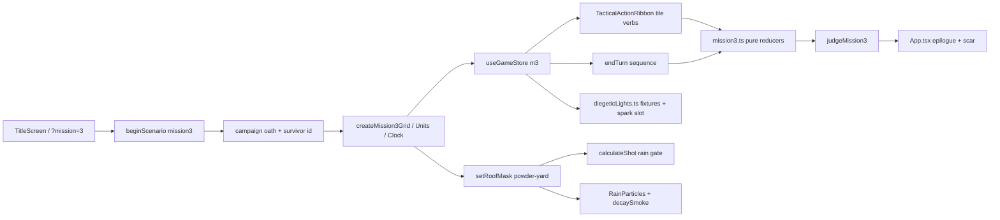
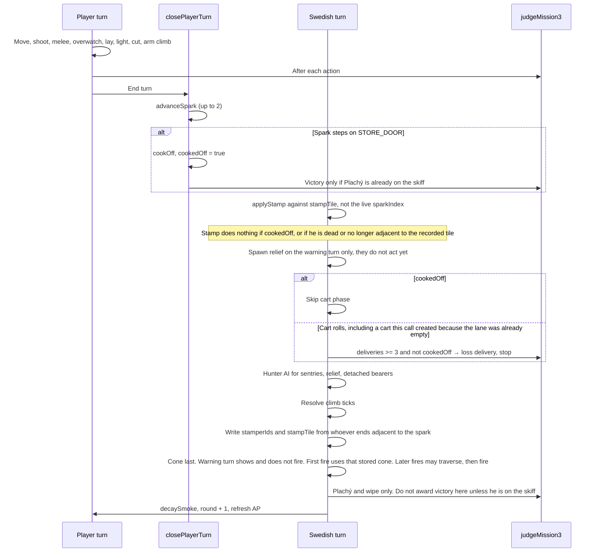

# Mission 3: Doutnák — Powder-Yard Sortie

| | |
|---|---|
| **Author** | Design draft (implementer of record: the mission owner) |
| **Date** | 2026-11-16 |
| **Status** | Implemented |
| **Scenario id** | `mission3` |
| **Locked names** | Mise 3: Doutnák, prachový dvůr, doutnáková stopa, jiskra, kára, nosič, dělmistr, kartáčový kužel, žák Klementina, pramice výsadku, jizva kroniky |

This document is the implementation spec for the whole playable mission. It does not reopen ADR-0019 or the glossary. Where the current code disagrees with those locks, the code changes. Names above are not renamed.

> **Implementation note**: Lines below written during the pre-implementation design phase (`"Nothing in the repo implements Mission 3"`, `"Not implementing in this task"`, `"in-memory without refresh"`) reflect historical draft state. Mission 3 is now implemented, roof masks are owned per `GridSystem` instance via `setInstanceRoofMask` (eliminating global `setRoofMask`), and `campaign` persists per browser tab in `sessionStorage` (ADR-0021).

---

## Overview

On the night of 27/28 July 1648 the portcullis at the Old Town Bridge Tower is already down. Father Jiří Plachý and exactly two others cross the Čertovka in a skiff and fire the powder the Swedes are carting out of a requisitioned coach house behind the Malá Strana bridge towers. The win is not a cleared yard. The store cooks off with fewer than three kegs already through the battery gate, and Plachý himself stands on a skiff tile afterwards. Men left alive are not cleared.

The new rule is one waxed cord. Everything else is a rule the company already has: the `powder_keg` obstacle, black-powder smoke, rain on an outdoor matchlock, high ground, a roofed room, and `damageTile` scars whose centers stay walkable. There is no second explosive, no stealth attribute, no turn-counter banner, no second kneeling, no blocking crater, and no infernal unit. The Swedes on this field are men: one dělmistr, nosiči, and matchlock soldiers.

The mission is a new headless module in the shape of `src/core/mission2.ts`, driven by the same Zustand turn loop. Presentation extends the existing practical-light census, the rain field, and the instanced battlefield. It does not add an engine.

---

## Background & Motivation

Mission 2 (`src/core/mission2.ts`, ADR-0016, ADR-0017) seats the portcullis on the morning of 26 July and then offers the blood-and-iron oath. ADR-0016 left later Swedes mortal unless a later ADR says otherwise. ADR-0019 is that decision: this yard is a coach house, not the Grand Priory, not Vrtbovská zahrada, not Prašná brána, and not the 1849 Petřín magazine. The occultist does not return. No one from Mission 1 stands here.

The pressure is the cart the player can see, not a banner that says the night has N turns. ADR-0019 rejected a numbered turn limit, winning by shooting kegs the way Mission 1 does, a second kneel, rain that snuffs the cord, and craters that seal the walk back. A shot on a single keg still detonates that keg through the existing `processExplosions` in `src/store/useGameStore.ts`. It does not fire the store. The store cooks off only when the jiskra enters the store-door tile.

Nothing in the repo implements Mission 3. `scenario` is `"mission1" | "mission2"`. `beginScenario` and `TitleScreen` know only those two. `oath` and `ironVigilPerk` live on the store and are set back to `null` inside `resetGame`. There is no `localStorage`. A title-screen launch of Doutnák therefore has no prior save unless this design adds one.

### Code the glossary overrides

| Lock | What the code does today | What Mission 3 does |
|---|---|---|
| Lodge matchlocks do not take the outdoor rain misfire | `calculateShot` in `src/core/CombatSystem.ts` adds `+14` (matchlock) or `+4` (other) whenever `weather === "rain"`, and never calls `isEnclosedRoofedCoord` | If the shooter tile is roofed, `weatherMisfireAdd = 0`. Smoke misfire (`+3`) is unchanged |
| Any non-null roof mask is the bridge | `getRoofParapetCover` in `src/core/GridSystem.ts` treats `roofMask !== null` as Charles Bridge parapets and the tower's west embrasures | A `roofKind` distinguishes `"bridge"` from `"powder-yard"`. Mission 3 must not inherit bridge cover |
| Cook-off smoke must still be there for the walk back | `applyExplosionShockwave` writes outdoor rain smoke as 1 turn; `decaySmoke` then subtracts 2 outdoors in rain | The scripted cook-off uses `addSmoke(..., 5)` on open court tiles and `addSmoke(..., 3)` under roofs. It does not use the rain-1 shockwave duration for the court cloud |
| Oath and the Mission 1 survivor must be able to reach this field | Both are cleared in `resetGame` | A `campaign` object on the store survives `resetGame` |
| Shooting a keg chains a 3×3 and removes the obstacle | Correct for a prachový sud, and it stays | The caller must not set `cookedOff` from that path |

Side effect, accepted: a Mission 2 defender shooting from a dry tower tile in the rain loses the outdoor misfire add, because the roof mask already says rain is not falling on him. Harriers on the open bridge are unchanged. No Mission 2 test asserts an indoor misfire number. A second accepted side effect: Havel's pace stays 6 after `applyBlackPowderChoking`, so Mission 2 no longer silently promotes him to 7 at the first Swedish turn.

There is no knockback anywhere in `src/`. The glossary still requires the player to kill a stamper, move him, or blow him off the tile. The mission-local rule is specified under Proposed Design. It is not a global physics change.

---

## Goals & Non-Goals

### Goals

- A 24×28 grid, floors y = 0 and y = 1 only, with every gameplay tile named below.
- A pure clock in `src/core/mission3.ts` that an engineer can test without React, following `judgeMission2` / `closePlayerTurn` / `closeEnemyTurn`.
- Party selection from the real oath fields, plus a legal cold-start preset.
- Player verbs wired through the existing action ribbon, Czech copy included.
- One resolution order so the same-round spark-versus-cart favor and the stamp telegraph cannot be reordered by accident.
- Win and loss copy in the Mission 2 epilogue pattern, including the chronicle scar.
- A lighting pass inside ADR-0015's slot budget and ADR-0018's night moon. No morning sun. No Vltava specular. No god-rays.
- A test list in the style of `scripts/test-mission2.ts`.

### Non-Goals

- Implementing the mission in this task.
- Editing `GLOSSARY.md` or any ADR.
- A new weapon, a new obstacle type, a new archetype, a stealth stat, a fuse minigame, a turn-limit banner, infernal glyphs, or a second kneel.
- Multiplayer, accounts, or a server. See Security.
- Persisting the campaign across a browser refresh. In-memory is the smallest addition that works. Refresh survival is an open question, not part of the first build.
- Balancing pass after the numbers in this document. Those numbers are the spec until playtest evidence changes them in a later ADR.

---

## Key Decisions

1. **The lane is one step long.** `LANE = [(16,0,8)]`, gate `(17,0,8)`. A longer lane lets a party that sat on the skiff through turn 1 still cook off before the third delivery. A zero-step lane (cart already on the gate at the start of Swedish turn 1, or a delivery before any player action) makes the turn-1 line late. The proof is the two-layer table in Proposed Design, replayed with orthogonal adjacency and `computeReachableTiles`. This is the ADR-0019 length constraint, not a tunable.

2. **A dropped keg does not seal the lane, and a kill does not move the delivery numbers.** The keg is the existing `powder_keg` on the cart's tile (`setObstacle`). Soldiers cannot walk that tile. The scripted cart index does not call `A*` and does not care. The next nosič stands on the shoulder `(16,0,9)`. The dead bearer's cart does not roll (glossary: without him it does not). The replacement is created on the next `advanceCarts` and rolls in that same call. After a PT1 kill or a PT1 cut, deliveries at the end of ST1, ST2, and ST3 are 1, 2, and 3. The same triple as a night where cart A lived. A pistol is not a way around the cord, and it is not a jam.

3. **When the lane empties changes who rolls this call.** A delivery empties the lane inside `advanceCarts`. That call sets `spawnQueued` and does not spawn. The next Swedish call creates the cart and rolls it. A kill or a cut empties the lane on the player turn, so the upcoming Swedish call is already "the Swedish turn after" the tile was empty: it creates the cart and rolls it. Both readings of the glossary ("rolls one tile on each Swedish turn" and "the mouth starts a new cart on the Swedish turn after the lane's first tile is empty") are satisfied by that split. The player never gets a turn against a cart that was born inside the call that delivers it.

4. **The on-time cord is four cobble tiles, laid by two bodies.** Anyone but Ondřej lays one tile per AP, and no square is orthogonally adjacent to two consecutive cord tiles, so one soldier adds at most one tile per turn. The door's only walkable orthogonal neighbor is `(11,0,10)`; `(12,0,11)` is `high_wall`, so the court cannot lay the door from the south. Two layers who move on PT1 reach length 2 and light; PT2 reaches length 3; PT3 lays the door and the spark enters it before ST3. The same party that waits is still at length 3 when ST3 delivers. The stair reach is the same four-tile tail, walked to after the climb and a descent. It is not a second cord, and it is not a one-move lay of the door.

5. **Ondřej's double lay buys back exactly one lost turn.** With him, a party that does nothing on turn 1 still cooks off at the end of player turn 3. On that PT3 he spends 1 AP walking to `(10,0,10)` and 1 AP laying `(11,0,10)` plus the door. It is not one AP. Without him, the same wait loses. Do not lengthen the lane or the cord to punish him; either change makes the two-student night unwinnable.

6. **Lighting a stub is legal.** Plachý does not wait for a finished train. Rain never removes cord tiles or the spark. A stamp clears `lit` and does not splice the array. Relight continues from the extinguished index.

7. **Stamp is telegraphed for a full player turn, against the tile recorded when the telegraph was written.** A Swede who ends Swedish turn N adjacent to the spark's tile is stored with that coordinate (`stampTile`). At the start of Swedish turn N+1 he stamps if he is still alive and still adjacent to `stampTile`, even if `advanceSpark` has since moved the index. Laying more cord is not a fourth answer. The glossary's three answers are kill, move, or blow him off that recorded tile. The spark moving next to him during the player turn does not make him a stamper early. Cook-off sets `cookedOff` before the Swedish turn, and a stamp does not undo it.

8. **Climbing is a channel, not `setStairs`.** `setStairs` costs one pathfinding step (`src/core/Pathfinding.ts`), and with `movePerAp` 6 or 7 everyone would reach y = 1 in one turn. The rope and the stair are windlass-shaped counters resolved in `closeEnemyTurn`. Ascent: Ondřej's rope 1 tick, stair 2 ticks. Descent: either, 1 tick, so a man who went up can come down. Wounds do not erase progress (the Mission 3 glossary does not say they do; do not copy the windlass stall). Leaving the foot, or dying, zeroes that climber's progress. Havel's authored pace stays 6 through `applyBlackPowderChoking`, so his 7-step walk to the stair foot still costs 2 AP on PT2 and later. Plachý's 7 still fits in 1 AP.

9. **"Blow him off the tile" is mission-local, because the repo cannot shove.** A prachový sud blast (`processExplosions`, damage 5, armor shred 2, Chebyshev ≤ 1) that leaves a living unit on the blast tile moves him one orthogonal step to the nearest walkable empty tile away from the center, searched E, N, W, S, then the diagonals. If none exists, he stays and still stamps. A melee hit does the same one-tile push along the attacker→defender line when the destination is walkable and empty. No generic knockback helper outside `mission3.ts`. Killing him also clears the stamp, which is the ordinary case.

10. **Cold start is Plachý, Havel Řezáč, Ondřej Štěrba.** `campaign.oath === null` means the title screen, or `?mission=3` with no Mission 2 result in this session. That preset is legal: both men swore. It is not used when Mission 2 wrote a real oath, including a refusal or a death. Students fill empty seats and are not offered the oath on this field.

11. **The Mission 1 survivor does not spawn.** If `campaign.mission1SurvivorId` is set, one chronicle line says he named the water gate. His perk is not copied onto anyone. ADR-0016 already says those perks do not apply on a later field; ADR-0019 says he does not fight here.

12. **Fog of war is off for this scenario.** The cart is the clock and must be on screen. Silence is a behavior flag, not concealment. Relief is hidden because those two units are not in the array until the break, not because a fog tile hides them. `fogOfWarEnabled` stays the store flag; the Mission 3 reset sets it false and does not touch Mission 1's fog.

13. **The distant Old Town torch is an emissive mesh, not a fourth point light.** ADR-0015 allows three torch-class slots. This mission uses the skiff lantern plus two yard torches. The tower coal is outside the field, casts no gameplay ring, and does not enter `selectSteadySlots`.

14. **Canister is not a shot, and the first fan is a lock.** It does not call `calculateShot`, does not misfire, and does not consult half cover. Damage is 7 HP, armor shred 1, on each living unit whose tile is in the cone and whose raw `bresenham3D` from the muzzle is not blocked (not `checkLineOfSight3D`; step-out must not open a cone). Blockers: `pillar`, `high_wall`, closed door. Not blockers: `low_wall`, `powder_keg`, half cover. Any unit with `y ≥ 1` is immune (the lodge). `damageTile(tile, 1)` on raked tiles only. Centers stay walkable. The warning Swedish turn, after hunters, climb ticks, and the stamper write, shows the cone and deals 0. The next Swedish turn fires that stored cone. It does not re-pick first. A traverse is allowed only on firing turns after that one, chosen and fired at the end of the same turn.

15. **Cook-off scars a listed polygon, then chains kegs and the in-yard cart through the existing explosion, clipped to that polygon.** Water and the skiff are outside it. A delivery already removed from the board is not chained. `damageTile` level 2 will clear `low_wall` gabions inside the polygon (existing behavior) and will not clear `pillar`. That is intended: after the blast the pillars still stop canister, the gabions do not stand.

---

## Proposed Design

### Architecture



New pure module: `src/core/mission3.ts`. The store holds `m3` the way it holds `m2`. React does not own the rules. `bindMission3Clock` mirrors `bindMission2Clock` so combat code can read the clock without importing the store from the core.

`src/store/useGameStore.ts` branches that today say `scenario === "mission2"` gain a `mission3` arm. `checkMissionOutcome` does not receive a scenario argument. When `readMission2Clock()` is null it falls through to Mission 1, and the first branch there is not the boat or the annihilation return. It is the Colloredo test: no `player-colloredo`, or one who is not alive, returns defeat `zero_hp` (or `captureReason`). Mission 3 fields Plachý and no Colloredo, so the first move, shot, or melee would lose before `judgeMission3` runs. Branch on `readMission3Clock()` **before** that Colloredo test and return `judgeMission3` only. Do not merely skip the `boat_escape` and `annihilation` returns; those lines are unreachable until Colloredo is present and alive. Widen `victoryReason` with `"skiff"` on `checkMissionOutcome` and on `GameStoreState`. Mission 3's `defeatReason` stays null; the epilogue reads `m3.loss`, which is not a `CaptureReason`. A living Swede does not lose the night. Plachý stepping on `isEscapeZone` before cook-off does not win it.

`App.tsx` today treats `missionParam === "2"` as Mission 2 and everything else as Mission 1, and a non-mission2 defeat always uses `ui.epilogue.defeatTitle`. PR 2 accepts `mission=3` and, until PR 4's cartouche exists, a Mission 3 outcome renders the Mission 3 title strings, never the Mission 1 captivity title.

### Map

One tile is 1.6 m, same as Mission 2. The grid is still `GRID_WIDTH = 24`, `GRID_DEPTH = 28`, `GRID_FLOORS = 3` (`src/core/GridSystem.ts`). This mission paints floors only on y = 0 and y = 1 inside the footprint below. y = 2 has no floor. Everything outside the footprint has `hasFloor = false`. The bridge is not a path: there is no walkable tile east of x = 17, and no portcullis object on the grid. The closed bridge and the Old Town tower are dressing beyond the last tile.

North is decreasing z, east is increasing x, same as `CARDINAL_OFFSETS`.

#### Regions

| Region | Tiles | Surface | Walk | Notes |
|---|---|---|---|---|
| Čertovka | x = 4..5, z = 8..14, y = 0 | `water` | no | Not the Vltava. No sun specular |
| Pramice výsadku | `(6,0,9)`, `(6,0,10)` | `wood_dock` | yes | `isEscapeZone`. Win tiles. Not cobble, so no cord. `(6,0,11)` has no floor |
| Bank | `(7,0,9)`, `(7,0,10)` | `cobble` | yes | Mooring. Still west of the choke |
| Choke | `(8,0,10)` | `cobble` | yes | The only tile from which the on-time tail can be laid |
| Light alcove | `(9,0,11)` | `cobble` | yes | Plachý stands here to light. Orthogonal only to the tail, not to `(10,0,10)` |
| Cord | `(9,0,10)`, `(10,0,10)`, `(11,0,10)`, `(12,0,10)` | `cobble` | yes | Ordered tail → door. Last tile is the store door |
| Cord canyon walls | `(8,0,9)`, `(9,0,9)`, `(10,0,9)`, `(11,0,9)`, `(12,0,9)`, `(10,0,11)`, `(11,0,11)`, `(12,0,11)` | stone, `high_wall` | no | The door `(12,0,10)` has one walkable orthogonal neighbor, `(11,0,10)`. The other three are these walls plus the store shell `(13,0,10)` |
| Store interior | `(13,0,8)`, `(14,0,8)`, `(15,0,8)`, `(13,0,9)`, `(14,0,9)`, `(15,0,9)` | `stone_floor` | yes | Roofed. Not cobble, so the cord cannot be laid inside |
| Store shell | `(12,0,8)`, `(13,0,7)`, `(14,0,7)`, `(15,0,7)`, `(16,0,7)`, `(13,0,10)` | stone, `high_wall` | no | East mouth stays open. `(16,0,8)` is the lane and `(16,0,9)` is the shoulder; both are walkable cobble, not walls. `(13,0,10)` is the wall the door threshold sits against |
| Lane | `(16,0,8)` | `cobble` | yes until a keg is dropped | The one lane tile. Cart token lives here |
| Battery gate | `(17,0,8)` | `cobble` | yes | Entering with a cart counts one delivery and deletes the cart. A soldier walking here does not |
| Bearer shoulder | `(16,0,9)` | `cobble` | yes | Nosič stands here, not on the keg |
| Open court | remaining y = 0 tiles with x = 7..17, z = 8..15 that are not walls, pillars, gabions, water, or dock | `cobble` | yes | Rain, except the soffit under the lodge |
| Pillars | `(15,0,10)`, `(11,0,13)` | `pillar` | no | Full small-arms cover via `bakeCoverFromObstacles`. Both stop canister |
| Gabions | `(16,0,12)`, `(17,0,11)` | `low_wall` | no | Half cover. Canister ignores them. Cook-off clears them |
| Falconet tile | `(17,0,10)` | `cobble` | yes | Muzzle coordinate. Not an obstacle. Orange barrel is dressing |
| Dělmistr | `(17,0,12)` | `cobble` | yes | He does not leave this tile |
| Stair foot / head | `(10,0,12)` / `(10,1,12)` | cobble / `stone_floor` | yes | Channel only. Not `setStairs` |
| Rope foot / head | `(8,0,12)` / `(8,1,12)` | cobble / `stone_floor` | yes | Ondřej only on the way up |
| Lodge | x = 8..15, z = 12..14, y = 1 | `stone_floor` | yes | Roofed gallery. No y = 1 floor on z ≤ 11 |
| Around court | `(7,0,11)`, `(8,0,11)`, `(9,0,11)`, `(9,0,12)` | `cobble` | yes | The second layer's path onto the tail. Not a second cord. `(12,0,11)` is a wall, not a step of this path |
| Relief door west | `(8,0,15)` | door in a `high_wall` run x = 8..11, z = 15 | closed | `setDoor`, id `relief-west`, axis `E_W` |
| Relief door south | `(12,0,15)` | door in the same run | closed | `setDoor`, id `relief-south`, axis `E_W` |
| South wall | `(9,0,15)`, `(10,0,15)`, `(11,0,15)`, `(13,0,15)`, `(14,0,15)`, `(15,0,15)` | `high_wall` | no | The two doors are the holes |
| Inner spawn tiles | `(8,0,14)`, `(12,0,14)` | `cobble` | yes | Where the second relief man stands |

No tile above is the Grand Priory parquet, `palace_carpet`, the belvedere, or the Maltese tower. Do not call `createInitialGrid`.

`createMission3Grid` calls `setRoofMask(isPowderYardRoofed)` the way `createMission2Grid` installs `isBridgeTowerRoofed`. `createInitialGrid` already clears the mask; keep that.

```ts
export function isPowderYardRoofed(x: number, y: number, z: number): boolean {
  const store =
    y === 0 && x >= 13 && x <= 15 && z >= 8 && z <= 9;
  const lodge = y === 1 && x >= 8 && x <= 15 && z >= 12 && z <= 14;
  // Soffit: the open court under the gallery stays dry, belvedere-arcade pattern.
  const soffit = y === 0 && x >= 8 && x <= 15 && z >= 12 && z <= 14;
  return store || lodge || soffit;
}
```

The cord at z = 10 is not roofed. It is rain. The store and the lodge are dry. Matchlocks on a roofed tile do not take `weatherMisfireAdd`. Indoor smoke still chokes through the existing `applyBlackPowderChoking`: armor > 0 and hp === maxHp resists; Plachý starts at armor 1 and full HP, so he resists until he is wounded or his armor is shredded. Students and Havel and Ondřej have armor 0 and do not resist.

Lodge lip cover, added in `getRoofParapetCover` only when `roofKind === "powder-yard"`:

- y = 1, z = 12, x = 8..15, direction S: `half` (balustrade toward the court).
- y = 1, x = 8, z = 12..14, direction W: `half`.
- y = 1, x = 15, z = 12..14, direction E: `half`.

No other Mission 3 parapet. Do not leave the bridge formula active.

#### Torches and the dark path

Gameplay torch rings are Chebyshev radius 1, same floor, around the two yard torches only. The skiff lantern is a practical light and is **not** a ring. Laying cord and walking outside the rings does not break silence. Stepping on a ring tile does.

| Id | Tile | Ring | Weather |
|---|---|---|---|
| `torch-lane` | `(16,0,10)` | x = 15..17, z = 9..11 | Open. Rain gutters the flame (ADR-0015). Ring still detects |
| `torch-gallery` | `(11,0,14)` | x = 10..12, z = 13..15 | Under the soffit, so the flame does not gutter. Ring still detects |

The on-time path uses `(7,0,9)`, `(7,0,10)`, `(8,0,10)`, `(9,0,11)`, and the cord at z = 10, x = 9..12. None of those tiles is in either ring. The shoulder `(16,0,9)` is in the lane ring. Cutting across the lit lane is a break. The canonical line never steps there.

#### Who starts where

| Id | Start | Facing |
|---|---|---|
| `player-plachy` | `(6,0,9)` | E |
| Seat 0 (Havel or first student) | `(6,0,10)` | E |
| Seat 1 (Ondřej or second student) | `(7,0,10)` | E |
| `enemy-bearer-1` | `(16,0,9)` | W |
| `enemy-gunner` | `(17,0,12)` | W |
| `enemy-sentry-1` | `(12,0,13)` | S |
| `enemy-sentry-2` | `(15,0,14)` | W |

Cart token at mission start: lane index 0, bearer `enemy-bearer-1`, `spawnQueued = false`, `deliveries = 0`.

`enemy-sentry-1` at `(12,0,13)` stands inside the gallery ring (x = 10..12, z = 13..15). `enemy-sentry-2` at `(15,0,14)` does not: x = 15 is outside that ring. `enemy-bearer-1` starts on the shoulder, which is inside the lane ring. Units who begin the mission on a ring tile do not break silence by standing there. A later Swedish spawn onto the shoulder does not break it either. Only a player unit's path step that enters a ring tile does. Keep sentry 2 on `(15,0,14)`.

### Clock proof

Definitions used by the tests. A "step" is one cardinal tile. `getNeighbors` in `src/core/Pathfinding.ts` offers N, E, S, and W only; a diagonal is not one step. `movePerAp` is 7 for Plachý and a student (`soldierMovePerAp(plachy_pistol | havel_pistol)` is 7 because `mobilityPenalty` is 0) and 6 for Havel, copied from `createMission2Units`. `computeReachableTiles` charges 1 AP when the path length is ≤ `movePerAp`, and 2 AP otherwise. Both heroes and students have `maxAp = 2`.

**Lay.** 1 AP. The layer must be orthogonally adjacent to the tile being added (N/E/S/W, same y). `isAdjacentForMelee` is the wrong test for a lay: it is Chebyshev and would accept a diagonal. The tile is empty cobble: `surface === "cobble"`, walkable, obstacle `none`, no unit, no cart token, not already in the train. The train is one ordered list, maximum 6. The new tile must be orthogonally chained from the current head, or it is the first tile. Anyone except Ondřej appends exactly one. Ondřej appends up to two, and he must be orthogonally adjacent to the first of those two; the second only has to chain from the first. No grid tile is an orthogonal neighbor of two orthogonally consecutive cells, so a second body cannot stand on one square and lay both. Laying does not break silence and does not spend the spark.

**Light.** Plachý only, 1 AP, `isAdjacentForMelee` to the tail (index 0). That includes a lodge tile directly above the tail, because `|dy| ≤ 1`. The on-time tail `(9,0,10)` is not under the lodge (lodge z starts at 12), so the lighting square on the race is `(9,0,11)`. He may light a train of any length ≥ 1. That sets `lit`. It breaks silence.

**Spark.** If `lit` at the end of the player turn, move the index forward at most 2, never past the current head, and never onto a tile that is not in the array. If a step's tile is `STORE_DOOR`, cook off immediately and stop. This runs on the lighting turn too.

The door's walkable orthogonal neighbors are only `(11,0,10)`. `(12,0,9)`, `(12,0,11)`, and `(13,0,10)` are `high_wall`. A court runner cannot lay the door from `(12,0,11)`. That tile is not cobble.

#### Turn-1 line, no Ondřej (two layers, one tile each)

Seat 1 is the student or, when the oath left Havel home, still a one-tile layer. Seat 0 is Havel (`movePerAp` 6, locked — see Units) or a student (`movePerAp` 7). Both budgets below use the slower number where it matters. Order is part of the line. Seat 1 moves first, then seat 0, then Plachý. Plachý does not lay on this line: his 2 AP are the walk and the light. A third lay on PT1 is not available anyway. Seat 0 ends on `(9,0,10)`, which is the only open square a third layer could pass to reach `(11,0,10)`.

| Turn | Actions | Train after the turn | Spark index at end | Deliveries after the Swedish turn |
|---|---|---|---|---|
| PT1 | Seat 1 `(7,0,10)` → `(8,0,10)` (1 step, 1 AP) and lays `(9,0,10)`. Seat 0 `(6,0,10)` → `(7,0,10)` → `(7,0,11)` → `(8,0,11)` → `(9,0,11)` → `(9,0,10)` (5 steps; 5 ≤ 6, so 1 AP) and lays `(10,0,10)`. Plachý `(6,0,9)` → `(7,0,9)` → `(7,0,10)` → `(7,0,11)` → `(8,0,11)` → `(9,0,11)` (5 steps, 1 AP) and lights. `(6,0,11)` has no floor, so seat 0 does not step there | length 2, lit | 1 (head is index 1; the second step has nowhere to go) | — |
| ST1 | Cone **shown**, not fired. Cart A steps `(16,0,8)` → `(17,0,8)`. Delivery 1. A and his bearer are removed. `spawnQueued = true`. Relief door opens on the break that the light just caused; men spawn here and do not act | | | 1 |
| PT2 | Seat 0, now on `(9,0,10)`, steps to `(10,0,10)` (1 AP) and lays `(11,0,10)` (1 AP). Seat 1 is on `(8,0,10)` and cannot pass seat 0, so nobody is adjacent to the door | length 3 | 2 | — |
| ST2 | Cone **fires the fan stored on ST1**. Cart B spawns on `(16,0,8)` and rolls into the gate on this same call. Delivery 2 | | | 2 |
| PT3 | Seat 0 steps `(10,0,10)` → `(11,0,10)` and lays `(12,0,10)`. Spark steps from index 2 onto the door | door | cook-off **before** ST3 | — |
| ST3 | Cart phase returns immediately because `cookedOff`. D stays 2 | | | 2 |

`(9,0,11)` is orthogonal to `(9,0,10)` and diagonal to `(10,0,10)`, so Plachý cannot lay the second tile from the alcove. The tests call `computeReachableTiles` for each of these walks and reject a lay whose layer is not orthogonally adjacent to the new tile.

Cook-off at the end of PT3 beats the third delivery, which is ST3. Same-round favor is this ordering, not a dice roll.

#### The same party waits on the skiff through PT1

Nobody moves to x ≥ 8. Nobody is adjacent to `(9,0,10)`, so no cord tile is laid. Cart A still delivers on ST1. The first action turn is PT2, and it can only do what PT1 did above: length 2, spark index 1. PT3 adds one tile (length 3, spark index 2). The door is index 3 and is not in the train. ST3 then delivers cart C. `deliveries === 3` and `cookedOff === false`. Immediate loss. There is no extract.

That is "waiting on the skiff loses." A single layer who does move on PT1 also loses: PT1 lays one tile, PT2 a second, PT3 a third, and the door is still unlaid when ST3 resolves. The party that wins is the one that puts both layers to work on turn 1. One soldier does not lay two tiles in a turn.

#### Why the lane is not zero steps and not two

- **Zero steps.** If A began already on the gate, or ST1 resolved before any player action, delivery 1 would be free and the spawn/roll pair would shift: D = 3 on ST2. The turn-1 line cooks off at the end of PT3, which is after ST2. The party that moved on turn 1 would already have lost. The one-tile lane is the shortest lane that still lets them win.
- **Two steps** (`L0`, `L1`, gate). With the same "spawn, then roll the cart that already exists; a cart created because the previous one delivered waits for the next call" rule, the third entry falls on ST4 or later. The waiting party needs one more action turn than the table, so their cook-off is the end of PT4, which is before ST4. Waiting would win. ADR-0019 forbids that. Do not add a second lane tile.

#### Ondřej buys back the lost turn

Ondřej on seat 1. He is orthogonally adjacent to the first new tile only. The second tile chains.

If the party waits on PT1, then on PT2 he steps `(7,0,10)` → `(8,0,10)` (1 AP) and lays `(9,0,10)` and `(10,0,10)` (1 AP). Plachý takes the 5-step alcove path and lights. Length 2, spark index 1. On PT3 Ondřej walks `(8,0,10)` → `(9,0,10)` → `(10,0,10)` (2 steps, 1 AP) and from there lays `(11,0,10)` and the door (the other AP). That is two AP, not one. Length 4. The spark advances from index 1 by 2 and enters the door at the end of PT3, before ST3. He still wins. A party with no Ondřej that waited is on length 3 at that moment and loses.

If he does the double lay on PT1 instead of waiting, the same walk-and-lay on PT2 puts the spark on the door at the end of PT2, with only one delivery on the board. Earlier than the student line. Still before ST3.

Do not "fix" the student night by making the cord six tiles. A six-tile cord that is still lightable on PT1 pushes the two-layer cook-off past ST3.

#### Store door within six tiles without Ondřej, via the stair

`STORE_DOOR = (12,0,10)`. The only cord is the four-tile canyon: `(9,0,10)`, `(10,0,10)`, `(11,0,10)`, `(12,0,10)`. Length 4 ≤ 6. There is no second train under the lodge. `(12,0,11)` is a wall, so the old three-tile drop from `(12,0,12)` does not exist, and a `movePerAp` 7 runner cannot stand there and lay the door.

The tail Plachý can reach is `(9,0,10)`. On the ground he stands on `(9,0,11)` on PT1, which is the race above. Via the stair, with nobody else helping him climb:

- PT1: path `(6,0,9)` → `(7,0,9)` → `(7,0,10)` → `(8,0,10)` → `(8,0,11)` → `(8,0,12)` → `(9,0,12)` → `(10,0,12)`. That is 7 steps. `movePerAp` 7, so 1 AP, and the second AP arms the stair. He is still on y = 0. None of these tiles is in a torch ring (the gallery ring starts at z = 13).
- End of ST1: stair progress 1. Not yet up.
- PT2: arm again, 1 AP.
- End of ST2: progress 2. He is placed on `(10,1,12)`.
- He is not yet beside the tail. Descent is one tick. PT3 arms the descent. End of ST3 he is on `(10,0,12)`.
- PT4: `(10,0,12)` → `(9,0,12)` → `(9,0,11)` (2 steps, 1 AP). `isAdjacentForMelee` to `(9,0,10)` is true. The second AP can light a train whose tail is that tile. The door is four cord tiles from it.

This route arrives after ST3. It does not win the race. It is how the night stays playable when Ondřej is absent and the only way onto the lodge is the stair: the tail is still a tile he can stand next to, and the door is still inside the six-tile cap. The on-time line never enters the lodge. The two sentences are not the same path, and they do not share a court tile that lays the door.

Havel's locked pace is 6. The same 7-step path costs him 2 AP (`7 > 6`), so he reaches the foot with nothing left and arms on PT2, then again on PT3, and arrives at the end of ST3. The two-tick test uses Plachý.

#### What the opening cart can and cannot do

Cart A is on the board during PT1. The legal shot is the bearer on the shoulder `(16,0,9)`, not the lane tile `(16,0,8)`. `checkLineOfSight3D` tries the direct ray, then each shooter step, then each target step. It never combines a shooter step with a target step. From `(9,0,11)` and from `(8,0,10)`, `canStepTo` reaches `(9,0,10)`, and `checkDirectRay3D` from there to `(16,0,9)` is clear. That ray is `(10,0,10)`, `(11,0,10)`, `(12,0,10)`, `(13,0,9)`, `(14,0,9)`, `(15,0,9)`. None of those is `high_wall`, `pillar`, or a closed door. The store interior at z = 9 is open floor. Do not put a wall on that ray: `(12,0,10)` is the door and `(13,0,9)` is the store.

The same two origins to `(16,0,8)` are blocked. A target step calls `checkDirectRay3D` from the original shooter, so moving the lane tile's peek onto the shoulder does not reuse the clear `(9,0,10)` ray. From `(9,0,11)`, the direct ray and the target step onto `(16,0,9)` both pass through `(10,0,11)` and `(13,0,10)`. A high wall blocks at index 1; only a pillar is peek-exempt there. The other walkable neighbors of the lane tile are walled too: `(17,0,8)` passes through `(10,0,11)`, and `(15,0,8)` passes through `(12,0,9)`. The shooter step to `(9,0,10)` aimed at `(16,0,8)` passes through `(11,0,9)` and `(12,0,9)`. From `(8,0,10)`, the direct ray to the lane tile passes through `(10,0,9)`, `(11,0,9)`, and `(12,0,9)`, and the step to `(8,0,11)` still hits `(12,0,9)`. `(11,0,9)` and `(12,0,9)` stay `high_wall`. They are why the door's only walkable orthogonal neighbor is `(11,0,10)`. Do not delete them to make the lane tile visible.

A shot at the bearer from the alcove or the choke on PT1 is legal and is a losing use of the body that should be lighting or laying. The delivery numbers after that kill are in the cart phase: ST1, ST2, and ST3 still end at 1, 2, and 3. The dead cart does not roll. The replacement spawned by the next `advanceCarts` does. Carts that spawn inside a Swedish resolution are not on the board during a player turn, so B and C are not a shot the player gets. Stopping the third delivery is the cord.

Cut tackle is a different ray. From `(14,1,12)` to the shoulder `(16,0,9)`, `bresenham3D` is `(14,1,12)`, `(15,1,11)`, `(15,0,10)`, `(16,0,9)`. The pillar `(15,0,10)` is index `ray.length - 2`. `checkDirectRay3D` exempts a pillar on that index (`allowAdjacentPillarPeek`). The ray is clear because of that exemption, not because the pillar is absent. The same pillar sits at an interior index on the direct ray to `(16,0,8)`, so that direct ray is blocked. The verb accepts bearer or lane tile; the shoulder is the one the test asserts with `checkLineOfSight3D`. Do not delete the pillar to "fix" the lane ray.

`checkDirectRay3D` also rejects an intermediate cell that travels under a non-ladder floor when `distFromUpper > 1`. The lodge must not gain a y = 1 floor at z ≤ 11. `(15,1,10)` and `(15,1,11)` have no floor, so the shoulder ray is not rejected by that rule. If a later dressing mesh adds one, delete the floor. Do not move the cart.

### Units

Factory: `createMission3Units(campaign: CampaignState): UnitData[]`, built on the same `blankUnit` shape as `createMission2Units` (hp, maxHp, ap 2, maxAp 2, `pistolLoaded`, `firearmLoaded`, `grenades: 0`, `marksmanship` 70 for the player side and 48 for the enemy side, copied from that function's defaults). Do not give anyone a `SpecialAbilityId`. Do not give anyone grenades. Mission 1 companions are not in the array: not `player-colloredo`, not `player-jan-matej`, not `player-bartolomej`, not `player-vaclav`, not `player-odowalsky`.

| Unit | Archetype | Weapon | Melee | HP | Armor | movePerAp | Notes |
|---|---|---|---|---|---|---|---|
| Jiří Plachý `player-plachy` | `commander` | `WEAPON_CATALOG.plachy_pistol` | `MELEE_CATALOG.thief_knife` | 12 | 1 | 7 | `isVip: true`. Role `Jezuitský páter`. Only he lights |
| Havel Řezáč `player-havel` | `ranger` | `havel_pistol` | `butcher_cleaver` | 11 | 0 | 6, locked | Role `Řezník od brány`. Seat 0 if `oath.havel === "accept"`. `applyBlackPowderChoking` must not rewrite him to 7 |
| Ondřej Štěrba `player-ondrej` | `sniper` | `ondrej_pistol` | `thief_knife` | 8 | 0 | 7 | Role `Zloděj střech a lan`. Seat 1 if `oath.ondrej === "accept"`. Lays 2. Rope. Cut tackle |
| Žák Klementina `player-zak-1` | `trooper` | `havel_pistol` | `thief_knife` | 7 | 0 | `soldierMovePerAp(havel_pistol)` = 7 | Seat 0 when Havel is not accepted |
| Druhý žák Klementina `player-zak-2` | `trooper` | `havel_pistol` | `thief_knife` | 7 | 0 | 7 | Seat 1 when Ondřej is not accepted |
| Nosič `enemy-bearer-N` | `ranger` | `swedish_musket` | `swedish_musket_butt` | 6 | 0 | `soldierMovePerAp` = 5 | Does not path and does not fire while `attachedToCart`. Later bearers use the same stats, ids `enemy-bearer-2`, `-3` |
| Dělmistr `enemy-gunner` | `trooper` | `swedish_musket` | `swedish_musket_butt` | 9 | 0 | 5 | Never fires the musket. Never leaves `(17,0,12)`. Not a `sectoid` |
| Švédská hlídka `enemy-sentry-1`, `-2` | `trooper` | `swedish_musket` | `swedish_musket_butt` | 7 | 0 | 5 | Matchlock. Outdoor rain misfire applies on the open court |
| Švédská posila `enemy-relief-1`, `-2` | `trooper` | `swedish_musket` | `swedish_musket_butt` | 7 | 0 | 5 | Spawned, not placed at dawn |

`swedish_musket` is the existing M1624 record: matchlock, `baseMisfireChance` 6, `fireApCost` 1, `reloadApCost` 2, `mobilityPenalty` 2, `overwatchMode: "prepared_volley_cone"`. Player sidearms are wheellocks. No new catalog row. The falconet is not a `WeaponStats`. Canister damage is a mission constant `CANISTER_DAMAGE = 7`, `CANISTER_SHRED = 1`.

`applyBlackPowderChoking` in `src/core/CombatSystem.ts` sets `movePerAp` from `soldierMovePerAp(u.weapon)` for every id except `player-colloredo` (hardcoded 3). `havel_pistol` has `mobilityPenalty` 0, so that call returns 7. `endTurn` runs the pass when the Swedish turn begins and again when player AP is refreshed. Havel's authored 6 would survive only until ST1. Extend the existing id exception: `player-havel` uses base pace 6, then the choke subtracts 1 if he is actually choking. Do not give him a new weapon. Mission 2's side effect is that Havel stops gaining a free +1 pace at the first Swedish turn. That restores the number `createMission2Units` already writes. A store assertion checks `movePerAp === 6` at the start of Mission 3 PT2, after one `endTurn`.

Students are `trooper` so the top-down set stays inside the five archetypes in ADR-0007. They are not offered the oath. They do not get Ondřej's rope, his two-tile lay, or his tackle cut.

Crimson sashes are a material tint on enemy meshes in `UnitVisual3D` / `UnitVisual2D` when `scenario === "mission3" && faction === "enemy"`. Color `#dc2626`. Not a new archetype. No censer, no glyph, no `sectoid` banner.

#### Party selection

```ts
export interface CampaignState {
  oath: {
    havel: "accept" | "refuse" | "fallen";
    ondrej: "accept" | "refuse" | "fallen";
  } | null;
  /** Mission 1 Iron Vigil hero id, if that night produced a survivor. Never spawned here. */
  mission1SurvivorId: string | null;
}

export const TITLE_PRESET_OATH = {
  havel: "accept",
  ondrej: "accept",
} as const;
```

Seat 0 is Havel if `oath.havel === "accept"`, otherwise `player-zak-1`. Seat 1 is Ondřej if `oath.ondrej === "accept"`, otherwise `player-zak-2`. `"refuse"` and `"fallen"` are both empty seats. The order is fixed seats, not "pack the sworn men to the front." A refused Havel and a sworn Ondřej is Plachý, a student, Ondřej.

`chooseOath` in the store already writes the in-memory `oath` after Mission 2. It must also write `campaign.oath` and must not clear `campaign` on `resetGame`. When Mission 1 sets `ironVigilPerk`, it also sets `campaign.mission1SurvivorId` to that `heroId`. `resetGame` continues to null the *scenario-local* `oath` and `ironVigilPerk` displays, and must not null `campaign`.

`beginScenario("mission3")` reads `campaign.oath ?? TITLE_PRESET_OATH`. The title card and `?mission=3` with a null campaign therefore field Plachý, Havel, and Ondřej. Say so in the briefing line: they are treated as having sworn. A real refusal from this session is not overwritten by the preset.

### Clock type

```ts
export const STORE_DOOR: GridCoord = { x: 12, y: 0, z: 10 };
export const LANE: GridCoord[] = [{ x: 16, y: 0, z: 8 }];
export const GATE: GridCoord = { x: 17, y: 0, z: 8 };
export const SHOULDER: GridCoord = { x: 16, y: 0, z: 9 };
export const MAX_CORD = 6;
export const SPARK_STEP = 2;
export const DELIVERY_LIMIT = 3;

export interface Mission3Clock {
  silent: boolean;
  silenceBrokenOnRound: number | null;
  cord: GridCoord[];          // index 0 = tail, last = head
  lit: boolean;
  sparkIndex: number;         // meaningful when cord.length > 0
  cookedOff: boolean;
  deliveries: number;         // 0..3
  cart: { bearerId: string; laneIndex: number } | null;
  spawnQueued: boolean;
  nextBearerSerial: number;   // starts at 2
  stamperIds: string[];       // enemies who ended the last Swedish turn adjacent to stampTile
  stampTile: GridCoord | null; // spark coordinate recorded with stamperIds; not re-read from sparkIndex
  cone: "lane" | "court" | "cord" | null;
  coneWarned: boolean;        // true after the warning Swedish turn has shown the cone
  coneFired: boolean;         // true after the stored warning cone has been fired once
  reliefDoor: "west" | "south" | null; // null until the break
  reliefSpawned: boolean;
  stairProgress: Record<string, number>; // unitId -> 0..2
  climbArmedId: string | null;
  climbKind: "stair" | "rope" | "down" | null;
  loss: "delivery" | "plachy" | "wiped" | null;
}
```

`freshClock()` sets `silent: true`, `cord: []`, `lit: false`, `sparkIndex: 0`, one cart, `spawnQueued: false`, `nextBearerSerial: 2`, `stamperIds: []`, `stampTile: null`, `cone: null`, `coneWarned: false`, `coneFired: false`. Do not assign `coneWarned = false` on a turn that is about to fire.

### Swedish AI

Pure function `computeMission3Ai`, the Mission 2 pattern (`computeMission2Ai` returns an `EnemyAiDecision`). The store's enemy loop already asks Mission 2 first. Add this branch before the generic `computeEnemyAiDecision`.

**While `silent`:**

- Bearer: no move, no shot. The cart phase is the only thing that moves him.
- Gunner: no move, no shot, cone stays null.
- Sentries: no move, no shot. They are at work and have not been given a target.
- No relief exists.

The cart phase still runs.

**On the player action that breaks silence** (`breakSilence(clock, reason)`):

- `silent = false`, `silenceBrokenOnRound = round`.
- Roll the door once: `rng() < 0.5 ? "west" : "south"`. Tests pass a fixed rng. Production uses `Math.random`, the same default as `rollRangedAttack`.
- Unseal and open that door with `grid.setDoorState`. The other stays sealed for the rest of the mission. There is no second roll.
- Chronicle: `log.m3.relief` names the door (`západní vrata` or `jižní vrata`).
- Do not spawn the men yet.

Both ids start in `grid.sealedDoorIds`. `isTilePassableForUnit` (`src/core/Pathfinding.ts`) treats a closed door as passable when the mover has an id (`allowClosedDoors`). The move resolver in `useGameStore.ts` then calls `setDoorState(step, "open")` for every closed door on the segment. `computeEnemyAiDecision` sets `doorToOpen` on any adjacent closed door, and the enemy loop opens it. A sealed id is exempt from all three: not a neighbor, not opened by the segment loop, not `doorToOpen`. Walking at a sealed leaf is a rejected step, not a breach, and it is not a silence break. The test paths a player onto the unchosen door and expects no path, and stands a hunter on the adjacent court tile with `doorToOpen === null`.

Reasons that call `breakSilence`: a player shot is attempted (hit, miss, or misfire), any explosion, any player melee roll (hit or miss), lighting, relighting, cutting tackle, a **player** path step that enters a torch-ring tile. Laying cord does not. Walking outside the rings does not. The cart rolling does not. A Swede who starts inside a ring, or a bearer spawned onto the shoulder, does not. The falconet does not traverse because of the cart.

**First Swedish turn after the break (the warning turn):**

1. Stamp check (see sequence). On the canonical PT1 light this *is* ST1, and `stamperIds` is empty.
2. Spawn relief if not spawned. `enemy-relief-1` on the open door tile, `enemy-relief-2` on the inner tile `(8,0,14)` or `(12,0,14)`. If a tile is occupied, use the other, then the nearest walkable empty court tile at Chebyshev ≤ 2. If both still cannot spawn, try again next Swedish turn. They do not act on the turn they spawn.
3. Cart phase.
4. Sentries, the gunner, and the bearer do not walk. The yard has looked up. The volley has not started. This keeps the canonical PT2 lay legal. Their hunter resolution is an empty move, and it still happens before the cone.
5. Resolve climb ticks.
6. If `lit && !cookedOff`, write `stampTile` and `stamperIds` the same way as a later turn.
7. Cone last, and this turn it does not fire. The gunner calls `selectCone` and stores it. The cone is shown. Damage is 0. `coneWarned` becomes true. `coneFired` stays false. Do not set `coneWarned` back to false.

**Each later Swedish turn:**

1. Stamp, before anyone moves, against `stampTile`. If `cookedOff`, skip the stamp.
2. Cart phase, unless `cookedOff`.
3. If `deliveries >= 3 && !cookedOff`, set loss `delivery` and stop the enemy loop. No further shots. No extract.
4. Sentries, detached bearers, and relief who are not newly spawned: `computeEnemyAiDecision` (the generic hunter in `CombatSystem.ts`). There is no Colloredo, so the capture branch does not run. They shoot players they can see, with the existing rain and smoke math. They do not step on the store door as an objective. They have no rite. A bearer who is still `attachedToCart` is skipped. His movement was the cart phase.
5. Resolve climb ticks.
6. If `lit && !cookedOff`, set `stampTile` to `cord[sparkIndex]` as it is now, and set `stamperIds` to every living enemy `isAdjacentForMelee` to that tile. Chronicle `log.m3.stamp.warn`: "Stojí u jiskry. Zašlápne ji na začátku příštího švédského tahu."
7. Cone, last. If `coneWarned && !coneFired`, fire the stored cone. Do not call `selectCone` before that shot. Set `coneFired`. If `coneFired` was already true, call `selectCone` now (he may traverse) and fire that new cone in the same end-step. The first damaging fan is the one the player saw through the whole intervening player turn. A later traverse is not a second telegraph.

Cone choice: among `lane`, `court`, and `cord`, pick the facing whose **post-ray** tile set contains the most living player units. Tie-break `lane`, then `court`, then `cord`. The lane facing is the one this field wants idle soldiers to fear. Listing:

```ts
export const CONES: Record<"lane" | "court" | "cord", GridCoord[]> = {
  lane: [
    { x: 16, y: 0, z: 8 }, { x: 15, y: 0, z: 8 }, { x: 15, y: 0, z: 9 },
    { x: 14, y: 0, z: 8 }, { x: 14, y: 0, z: 9 },
  ],
  court: [
    { x: 16, y: 0, z: 11 }, { x: 15, y: 0, z: 11 }, { x: 15, y: 0, z: 12 },
    { x: 14, y: 0, z: 11 }, { x: 14, y: 0, z: 12 }, { x: 13, y: 0, z: 12 },
    { x: 16, y: 0, z: 10 },
  ],
  cord: [
    { x: 16, y: 0, z: 10 }, { x: 15, y: 0, z: 10 }, { x: 14, y: 0, z: 10 },
    { x: 13, y: 0, z: 10 }, { x: 12, y: 0, z: 10 }, { x: 11, y: 0, z: 10 },
    { x: 15, y: 0, z: 9 }, { x: 15, y: 0, z: 11 },
  ],
};
```

`canisterHits(grid, origin, tile)` is false when any intermediate cell of `bresenham3D(origin, tile)` has `pillar`, `high_wall`, or a closed door. Origin is `(17,0,10)`. The pillar at `(15,0,10)` sits on the cord ray, so `(14,0,10)` and every cord tile west of it are not hit even if the gunner selects `cord`. The test locks that. `(16,0,10)` is in front of the pillar and can be hit. The alcove `(9,0,11)` and the choke `(8,0,10)` are in no cone. Lodge tiles are immune before the ray test.

A unit on a gabion's neighbor still takes the hit if his own tile is a surviving cone tile. Half cover is not consulted. After the shot, `damageTile(tile, 1)` on each surviving cone tile that has a floor and is not water. Do not call `damageTile(..., 2)`. Do not `setObstacle`.

### Cart phase

`advanceCarts(clock, grid, units): { clock, units, delivered: boolean }`

Order, inside one Swedish turn, after the stamp:

1. If `cookedOff`, return immediately. The cook-off helper has already chained whatever cart and kegs were on the board.
2. If `spawnQueued` and `cart === null`, spawn `enemy-bearer-${serial}` on `SHOULDER` if that tile is empty of a living unit, otherwise on the nearest empty walkable court tile at Chebyshev ≤ 2 that is not the gate. Create the cart token at lane index 0 even if that tile already holds a `powder_keg`. Increment serial. `attachedToCart` is true on the new bearer. This new cart **will** roll in step 3. A cart created because the previous delivery emptied the lane is not created in the call that delivered it; that call only sets `spawnQueued` in step 5, and this step runs on the next call.
3. If `cart !== null` and its bearer is alive and `attachedToCart`:
   - Next index is `laneIndex + 1`.
   - If next index === `LANE.length` (that is, 1), the step is the gate. `deliveries += 1`. Remove the cart token. Remove the bearer from `units` (he goes through with the keg). He is not a keg on the gate, because a delivery has left the yard and must not chain later.
   - Else move the token to that lane index and move the bearer with it onto the shoulder for that index. This mission has one shoulder because it has one lane tile; a cart that has not entered the gate is always on `(16,0,8)` / `(16,0,9)`.
4. If the bearer is dead or detached, the token is already gone (it was removed at the moment of death or the cut).
5. If `cart === null`, set `spawnQueued = true`. Otherwise `spawnQueued = false`.

Death of an attached bearer, resolved on the player turn when HP crosses the Mission 2 fall line (`!alive || hp <= 0`, including the end of death throes):

- `grid.setObstacle(LANE[0], "powder_keg")`.
- Cart token cleared.
- `spawnQueued` becomes true. The dead cart does not roll. The next `advanceCarts` spawns the replacement and rolls it in that same call.
- The dropped keg does not stop that new cart. The new bearer uses the shoulder. The keg stays on `(16,0,8)` and makes it unwalkable for soldiers.
- Chronicle `log.m3.cart.drop`.
- Numbers, kill on PT1 before any `advanceCarts`: end of ST1 `deliveries === 1`, end of ST2 `=== 2`, end of ST3 `=== 3` unless `cookedOff` already stopped the phase. Same triple as an unkilled A.

If `(16,0,8)` already holds a `powder_keg` when a later bearer dies, leave the obstacle. Do not invent a second keg type.

**Cut tackle.** Ondřej, y = 1, on a lodge tile, 1 AP, `checkLineOfSight3D` clear to the bearer or to `LANE[0]`. Same drop and the same delivery triple as the kill, except the bearer is **not** removed: `attachedToCart = false`, he stays on the shoulder, and from the next Swedish turn the hunter AI runs him as a musketeer. Breaks silence. A PT1 cut ends ST1 / ST2 / ST3 at deliveries 1, 2, and 3. Cutting does not buy a skipped keg.

The shoulder test is `checkLineOfSight3D(grid, {x:14,y:1,z:12}, {x:16,y:0,z:9}).clear === true`, and the assertion comment names the pillar exemption (`ray.length - 2`). Do not assert the lane tile. A y = 1 floor on z ≤ 11 would fail the shoulder ray via `distFromUpper > 1`; delete that floor if a mesh adds it.

### Cord, stamp, relight

`layCord(clock, layer, tiles: GridCoord[]): Mission3Clock | null` returns null if any tile fails the empty-cobble test, if the result would exceed 6, or if the layer lacks 1 AP. Ondřej may pass two tiles, anyone else exactly one.

`lightCord(clock, plachy)` and `relightCord` are the same function. Relight requires `cord.length > 0 && !lit && !cookedOff` and Plachý adjacent to `cord[sparkIndex]` (the dead spark), not necessarily the original tail. It sets `lit` and does not change `sparkIndex` or splice burned tiles. Tiles with index `< sparkIndex` stay in the array forever. They count toward the 6. The player cannot relay them and does not need to.

`advanceSpark` is only called from `closePlayerTurn`, after climb arming has been recorded and before the function returns. If the advance enters `STORE_DOOR`, set `cookedOff` and call the cook-off mutator on the grid and units before `closePlayerTurn` returns. The store then skips the Swedish cart delivery.

Stamp at the start of the Swedish turn:

```ts
export function applyStamp(clock: Mission3Clock, units: UnitData[]): Mission3Clock {
  if (!clock.lit || clock.cookedOff || !clock.stampTile) {
    return { ...clock, stamperIds: [], stampTile: null };
  }
  const tile = clock.stampTile;
  const stillThere = clock.stamperIds.some((id) => {
    const u = units.find((unit) => unit.id === id);
    return !!u && u.alive && u.hp > 0 && isAdjacentForMelee(u.pos, tile);
  });
  if (!stillThere) return { ...clock, stamperIds: [], stampTile: null };
  return { ...clock, lit: false, stamperIds: [], stampTile: null };
}
```

`applyStamp` does not read `sparkIndex`. A spark that advanced during the player turn is still extinguished if the recorded Swede is alive and still adjacent to `stampTile`. He does not have to be standing on that tile. The cord array is untouched. `sparkIndex` stays where `advanceSpark` left it. Plachý relights from a neighbor of that index on the following player turn. Extending the train is not a save.

### Cook-off

`YARD_SCAR` is every y = 0 tile with a floor, x = 7..17, z = 8..15, plus every lodge tile y = 1, x = 8..15, z = 12..14. It does not include x ≤ 6 (skiff and bank edge of the dock) and does not include x = 4..5 (water).

`cookOff(grid, units, clock)`:

1. For each scar tile that is not `water`: `grid.damageTile(tile, 2)`. Centers stay walkable because `damageTile` does not clear walkable except when it removes a `low_wall`, which it then marks walkable again. Pillars remain. Gabions inside the scar are removed by the existing level-2 branch. Debris stays on the mesh edge (the instanced ruin already places it at the perimeter, ADR-0007's ±0.35 m). Do not add a center prop.
2. Collect blast seeds: `STORE_DOOR`, the cart tile if `cart !== null`, and every `powder_keg` whose coord is inside the scar. `processExplosions` is a private function in `useGameStore.ts`. It always calls `applyExplosionShockwave`, which writes 0 smoke on the epicenter. Move the loop into `src/core/explosions.ts` as `applyPowderBlast(grid, units, origin, { damage: 5, armorShred: 2, shockwave, clip })`. The store wrapper keeps today's call: shockwave on, no clip. `cookOff` calls it with `shockwave: false` and a clip that refuses any tile outside `YARD_SCAR`, any `water`, and any `isEscapeZone`. The store door's 3×3 is x = 11..13, z = 9..11. The lane keg's 3×3 is x = 15..17, z = 7..9. Neither contains x ≤ 6.
3. Remove the in-yard cart token without incrementing `deliveries`. That keg has chained, not been delivered. Bearers on a seed tile take the blast like any other unit.
4. Smoke: `addSmoke(tile, 0, 5)` for scar tiles that are **not** roofed, `addSmoke(tile, 0, 3)` for roofed scar tiles. Do not call `applyExplosionShockwave` for this cloud. `decaySmoke` runs at the end of the Swedish turn, before the next player turn, so the walk back does not start on 5. Court rain subtracts 2: the first player turn after cook-off sees 3, the next sees 1, the next sees 0. Roofed smoke subtracts 1, except a tile within Chebyshev 2 of an open exterior door on the same floor. `getOpenExteriorDoors` treats a relief door as exterior because z = 15 is not inside `isPowderYardRoofed`. Once a relief door is open, `(10,0,14)` drafts by 2. Chebyshev distance to `(12,0,15)` is 2, and distance to `(8,0,15)` is also 2, so either rolled door does it. `(8,0,12)` is distance 3 from the west door and distance 4 from the south door, so it still subtracts 1. The lodge is y = 1, and the draft check requires `door.coord.y === c.y`, so y = 1 stays on the slow decay. `applyBlackPowderChoking` still cuts `movePerAp` by 1 indoors. Two consecutive smoked tiles block same-level LOS (`checkDirectRay3D`, `maxConsecutiveSmoke >= 2`). The lodge's high-ground pierce still allows two smoked tiles (`> 2` blocks).
5. `cookedOff = true`. Do not set victory. Plachý still has to reach a skiff tile. Enemies still act on the Swedish turn, minus the cart delivery and minus the stamp.

A single keg shot keeps using `processExplosions` unchanged, including its shockwave. It must not call `cookOff` and must not set `cookedOff`, even if the 3×3 touches `STORE_DOOR`.

### Climbs

Arming costs 1 AP and requires the unit to be standing on the foot (ascent) or the landing (descent).

| Kind | Who | Ticks resolved at end of Swedish turn | Arrival |
|---|---|---|---|
| Rope up | Ondřej only, on `(8,0,12)` | 1 | `(8,1,12)` |
| Stair up | Any living party member, on `(10,0,12)` | 2 | `(10,1,12)` |
| Down | Any living party member, on the matching landing | 1 | The foot of that channel |

Progress increments only if `climbArmedId` is that unit and they are still on the foot or landing at the end of the Swedish turn. Otherwise that progress resets to 0. A hit does not reset it. Ondřej may use the stair; it still takes two ticks. Everyone else arming the rope returns null.

No `setStairs`, no `isLadder`. The test that A* cannot change floor is mandatory. `findPathAStar` from `(10,0,12)` to `(10,1,12)` returns no path.

### Win and loss

`judgeMission3(clock, units): { outcome, victoryReason, loss }`

Check in this order, same priority style as `judgeMission2`:

1. Plachý missing or not `isUnitFighting(plachy)` (dead, not `alive`, or expired past Death Throes) → defeat, `loss: "plachy"`. During his 1-turn *Poslední vzepětí* (Death Throes), Plachý remains fighting and may reach the skiff (ADR-0012), matching `judgeMission2`'s Plachý check.
2. No player unit passes `isUnitFighting(u)` → defeat, `loss: "wiped"`. If Plachý is already fallen, rule 1 fires first.
3. `deliveries >= 3 && !cookedOff` → defeat, `loss: "delivery"`. Immediate. Do not keep resolving the Swedish turn.
4. `cookedOff && deliveries < 3` and Plachý is on `(6,0,9)` or `(6,0,10)`, `isUnitFighting(plachy)` → victory, `victoryReason: "skiff"`. Enemies may be alive.
5. Otherwise ongoing.

Victory is not "cook-off alone" and not "everyone extracted." Companions may be dead or still in the yard.

Call `judgeMission3` after every player action, after `advanceSpark`, after the stamp, and after the cart phase. The first non-ongoing result sticks.

Scar, not a grade: `deliveries === 0` is victory, battery mute. `deliveries === 1 || deliveries === 2` is the same victory, battery spoke once. The epilogue body changes. The title does not. There is no star row and no partial-failure loss.

### Resolution order



The same-round favor is the arrow from `advanceSpark` to cook-off **before** the cart phase of that round. A cart that would have been the third delivery on that Swedish turn chains or is skipped. It does not increment `deliveries`.

The stamp telegraph is the gap between "write `stamperIds` and `stampTile` at the end of Swedish turn N" and "applyStamp at the start of Swedish turn N+1". The entire player turn N+1 sits in that gap. Advancing the spark does not move `stampTile`. A Swede who only becomes adjacent because the spark moved during the player turn is not in `stamperIds` yet. He can be written at the end of the upcoming Swedish turn, which gives the player the turn after that.

Cone resolution is the last Swedish step, after hunters and climbs. The diagram and the store hook use this order. Do not fire before the hunters move.

### Player verbs and the ribbon

The tactical ribbon stays the Mission 2 strip in `src/components/ui/TacticalActionRibbon.tsx`: Move `[1]`, Shoot `[2]`, Overwatch `[3]`, Reload, Melee, End `[Space]`. Grenade stays hidden because `grenades === 0` (the existing disabled path). No ability on key 5. Lighting is not a cooldown ability and not a bless. It is a tile verb, shown the way Kneel is shown: a contextual button that exists only when the selected unit is on a legal tile.

| Verb | Shown when | AP | Czech label | Breaks silence |
|---|---|---|---|---|
| Move | always, existing | 1 or 2 | existing `ui.ribbon.move` | Only if a step enters a torch ring |
| Shoot | existing | weapon `fireApCost` | existing | Yes, including misfire |
| Overwatch | existing | existing | existing | The shot, when it later fires, yes. Setting overwatch does not |
| Melee | existing | 1 | existing | Yes, including a miss |
| Položit doutnák | Layer adjacent to a legal next cobble, train not full, not cooked off | 1 | `Položit doutnák, 1 AP`. Ondřej: `Položit dva články, 1 AP` | No |
| Zapálit stopu | Plachý, train length ≥ 1, not lit, adjacent to the tail | 1 | `Zapálit stopu, 1 AP` | Yes |
| Znovu zapálit | Plachý, train exists, not lit, not cooked off, adjacent to `cord[sparkIndex]` | 1 | `Znovu zapálit, 1 AP` | Yes |
| Přeříznout postraňky | Ondřej, y = 1, LOS to the live cart or its bearer | 1 | `Přeříznout postraňky, 1 AP` | Yes |
| Po laně | Ondřej on `(8,0,12)`, not already armed | 1 | `Po laně na lodžii, 1 AP` | No |
| Na schody | Any party member on `(10,0,12)`, not already armed | 1 | `Vystoupat po schodech, 1 AP` | No |
| Dolů | Any party member on a landing | 1 | `Sestoupit, 1 AP` | No |

Click only, no new number keys, same as `ui.ribbon.kneel`. Store actions mirror `kneelAtInscription`: guard `scenario === "mission3"`, `turn === "player"`, `!isBusy`, `outcome === "ongoing"`, then the pure function, then spend 1 AP, then `judgeMission3`, then a chronicle line.

Hovering a legal cord tile while the lay button is armed previews the one or two tiles in gold `#facc15` at 35% opacity, using the movement-zone overlay path in `InstancedBattlefield.tsx`. Not a new ribbon page. Invalid tiles get the existing red reject, no preview.

### End presentation

Follow the Mission 2 branch in `src/App.tsx` (the `outcome !== "ongoing"` cartouche). Do not reuse the Mission 1 boat epilogue or the oath buttons. Students are not offered the oath. There is no oath UI on this screen.

Title, victory: `Doutnák dohořel`.

Meta line: the existing `ui.epilogue.victoryMeta` round counter.

Body, `deliveries === 0`:

> Prachový dvůr vzplanul a brána baterie nedostala ani jednu káru. Za úsvitu baterie mlčela. Věž držela.

Body, `deliveries === 1` or `2` (the scar, same victory):

> Prachový dvůr vzplanul. Baterie za úsvitu promluvila jednou a věž držela.

Defeat title: existing `ui.epilogue.defeatTitle` is the Mission 1 captivity line. Do not reuse it. Mission 3 defeat title: `Noc se nepodařila`.

| `loss` | Body |
|---|---|
| `delivery` | Třetí kára projela branou baterie dřív, než jiskra vešla do dveří skladu. |
| `plachy` | Jiří Plachý padl. Bez něj se zpráva o doutnáku nevrátí. |
| `wiped` | Celý výsadek padl. |

Chronicle lines use `phrase()` and `cs-messages.ts`, the `log.m2.*` pattern. Minimum set:

- `log.m3.briefing` — "Noc z 27. na 28. července 1648. Mříž na Staroměstské věži je dole. Pramice výsadku přiráží k Čertovce za malostranskými mosteckými věžemi."
- `log.m3.watergate` — only if `campaign.mission1SurvivorId !== null`. "Přeživší od Čertovky jmenoval vodní branku. Na dvůr s vámi nevstupuje."
- `log.m3.cord.lay`, `log.m3.spark.light`, `log.m3.spark.advance`, `log.m3.spark.stamp`, `log.m3.spark.relight`
- `log.m3.cart.roll`, `log.m3.cart.delivery` (includes the new total), `log.m3.cart.drop`, `log.m3.tackle`
- `log.m3.silent.break` (names the reason: výstřel, výbuch, čepel, doutnák, postraňky, oheň pochodně)
- `log.m3.cone.show` — "Dělmistr odkryl kartáčový kužel. Tento tah ještě nestřílí."
- `log.m3.cone.fire`
- `log.m3.cookoff` — "Sklad vzplanul. Dvůr je spálený. Čertovka hoří není."
- `log.m3.victory.mute`, `log.m3.victory.scar`, `log.m3.loss.delivery`, `log.m3.loss.plachy`, `log.m3.loss.wiped`
- `log.m3.relief`
- `log.m3.climb` — "Ondřej je na lodžii." / "Výsadek je na lodžii." / "Sestup skončil."

`MissionStatusChip` gains a Mission 3 segment, not a turn fraction: `Káry ${deliveries}/3` and one of `Ticho`, `Jiskra`, `Zašlápnuto`, `Sklad hoří`. The existing round number stays. That is the cart clock, which ADR-0019 wants visible, and it is not a turn-limit banner. Turn splash copy, same component as Mission 2: player `Tah výsadku`, enemy `Tah švédské hlídky`. One second, then the chip. No "kolo 4 z 7".

Weather on the chip stays déšť. `resetGame` for this scenario sets `weather: "rain"`, `activeFloor: 0`, `renderMode: "3D_MODEL"` (same as Mission 2's reset, not Mission 1's sprites), `fogOfWarEnabled: false`, `guidedTutorial.enabled: false`, `reinforcementRound: 99`, `reinforcementsSpawned: true` so the Mission 1 reinforcement logs do not fire. The `endTurn` branch that pushes `log.warn.reinforcement` when `scenario !== "mission2"` must also exclude `mission3`.

Opening chronicle, in order: briefing, optional water-gate line, then nothing else. Do not print a plan.

### Lighting and dressing

Extend, do not replace:

| File | Change |
|---|---|
| `src/components/canvas/diegeticLights.ts` | Widen `fixturesForScenario` to `mission3`. Add `POWDER_YARD_FIXTURES`: lantern is already `evaluateLantern` on the escape tile; two torches as above. Add `sparkSample(clock)` that occupies matchcord slot 0 when `lit`, color `#facc15`, position on the spark tile at 0.15 m, radius `MATCHCORD_RADIUS`. Portfire at `(17,0,10)` occupies slot 1, color `#f97316`, outdoor so `applyWeather` gutters it in rain. Priority over enemy matchlock glows: the spark wins a slot the way a shrouded cord already outranks a nearer coal. `MAX_MATCHCORD_SLOTS` stays 2. `MAX_TORCH_SLOTS` stays 3 (lantern + two torches). No candelabrum; `MAX_CANDELABRA_SLOTS` stays 4 and this mission uses 0 |
| `src/components/canvas/TacticalScene.tsx` | `scenario === "mission3"` uses `MISSION1_MOON_POSITION` `[14, 28, 13]`, never `MISSION2_SUN_POSITION`. Intensities use the non-morning rain branch (`keyIntensity` 0.7, ambient 0.26, hemi 0.38). Shafts stay off (`beamCourt` / `beamGarden` visible only when not mission 2 **and** not mission 3). Practicals only besides that dim moon |
| `src/components/canvas/InstancedBattlefield.tsx` | Branch `scenario === "mission3"` beside `isMission2`. Cobble and stone and water materials already exist. Scar `scorched_ruin` already draws perimeter debris. Cord tiles: a flat gold braid decal, 0.05 m tall, inset so the tile center stays bare. Spark: a short gold coal on the live index. Cone: a dim crimson hatch `#dc2626` at 20% on the warned tiles, not a light. Kegs stay the existing orange barrel mesh `#f97316` |
| `src/components/canvas/RainParticles.tsx` | No new emitter. `isEnclosedRoofedCoord` already skips roofed tiles once the mask is installed. Confirm the mission 3 reset calls `setRoofMask` before the first frame |
| `src/components/canvas/CombatAtmosphereField.tsx` | No indoor ash at start. Existing rule: ash grows from `blastZones` and `smokeTiles` only. Cook-off creates those |
| `src/components/canvas/PragueSurroundings.tsx` | The `Mission` union gains `mission3`. Do not draw the Priory, the bridge deck, or Vltava specular. A dark mass stands in for the Malá Strana towers and a shut arch, outside the grid |
| New `src/components/canvas/PowderYardDressing.tsx` | Coach-house shell, gallery posts, falconet and gabion meshes, two door leaves, rope coil on `(8,0,12)`, stair treads on `(10,0,12)`, distant emissive coal for the Old Town tower. Emissive only, no `FixtureDef`. 30% sandstone `#7d7267` and timber, 60% left to the cobble. No oil paintings, no gold brocade, no Maltese cross as a faction mark |
| `src/components/canvas/UnitVisual2D.tsx`, `UnitVisual3D.tsx` | M3 variants and enemy sash tint. Headgear heights stay at `y ≈ 1.48–1.54` (2D) / `y ≈ 1.28–1.30 m` (3D) |
| `src/components/ui/TitleScreen.tsx` | Third card. Index `Mise III`, when `Noc`, place `Prachový dvůr u mosteckých věží`, title `Doutnák`, chip `Tři káry`, body one sentence: "Páter a dva muži. Doutnák do skladu dřív, než třetí kára projede branou." The grid becomes three columns on `md` |
| `src/App.tsx` | `?mission=3` beside the existing `mission=2` query. Epilogue branch |
| `src/i18n/cs-ui.ts`, `cs-messages.ts` | Every string in this document. No raw Czech in components (ADR-0001) |
| `src/core/CombatSystem.ts` | Rain misfire gate inside `calculateShot`. Havel pace 6 beside the Colloredo exception in `applyBlackPowderChoking`. Skip sealed doors in the `doorToOpen` loop |
| `src/core/GridSystem.ts` | `roofKind`, lodge parapet, `sealedDoorIds`. `setRoofMask` stays |
| `src/core/explosions.ts` | New home of the keg loop, so cook-off can skip the shockwave |
| `src/core/Pathfinding.ts` | A sealed door is not passable, even when `allowClosedDoors` is set |

60-30-10 on this night: the court cobble is the 60% (existing slate cobble, low contrast, no brocade). Walls, gabions, timber, and the falconet carriage are the 30%. The 10% is the gold spark and cord, the orange kegs and barrel and portfire, and the crimson sashes plus the cone hatch. Blue and gold movement zones stay as they are; they are the tactical read, not decoration. No infernal glyph. No candle in the open court. Wheellocks stay dark until they fire, existing rule.

Chiaroscuro: moon is dim, borders beyond x = 4 and x = 17 have no floor and no fill light, the playable court is picked out by the two torches, the lantern, and later the spark. Rain streaks glint only near those flames (`RAIN_GLINT_RADIUS` already).

Ballistics are untouched: muzzle at `MUZZLE_FORWARD_M = 0.58`, recoil, 730 ms arrival (`1780 ms` lifecycle), ricochet. Canister is not a projectile trace. It is a cone flash using the existing blast-light pool (`MAX_BLAST_LIGHTS = 2`) at the muzzle tile for one shot, then the damage. Do not add a tracer mesh.

### Store integration map

`beginScenario` widens to `"mission1" | "mission2" | "mission3"`. Implementation copy for the Mission 3 reset is the Mission 2 block in `resetGame` (grid factory, `projectUnit`, first selected id `player-plachy`, weather rain, empty tutorial, combat log of the briefing). Differences: `m3: freshClock()`, `m2: null`, `activeFloor: 0`, `fogOfWarEnabled: false`, party from `createMission3Units`.

`endTurn` currently calls `closePlayerTurn` only for Mission 2, then runs the enemy loop, then `closeEnemyTurn`, then `decaySmoke`. Mission 3 hooks:

- Before the enemy loop: `closePlayerTurn` → spark → maybe cook-off → judge. `checkMissionOutcome` for this scenario is `judgeMission3`, not the Colloredo branch.
- At the top of the enemy phase, before the per-unit AI: stamp against `stampTile`, relief spawn, cart phase, judge.
- Per unit: `computeMission3Ai` when `scenario === "mission3"`. The warning turn's sentries and gunner return an empty move. `doorToOpen` is ignored when the id is sealed.
- After the last unit, in this order: climb ticks, write `stamperIds` and `stampTile`, then cone warning or cone fire, judge, `decaySmoke`. The cone is last. The first fire uses the stored warning cone.

Movement into a ring checks each step inside the existing move resolver, not only the destination. A path that clips `(16,0,9)` breaks silence on the step it enters, even if the unit dies later on that path.

Overwatch remains the existing system. A player standing on the lane tile is a legal overwatch position and a bad one: the lane cone does not care. Do not special-case overwatch.

`cycleWeather` may stay for debugging. The mission's own rules assume rain. Tests that care pass `"rain"` into `calculateShot` explicitly, as Mission 2 does.

---

## API / Interface Changes

`scenario` on `GameStoreState` becomes `"mission1" | "mission2" | "mission3"`. `beginScenario` takes the same union. `m3: Mission3Clock | null` sits beside `m2`. `campaign: CampaignState` sits beside them and is not reset.

New exports from `mission3.ts`. Pure clock reducers return a new clock and do not touch the grid: `freshClock`, `layCord`, `lightCord`, `advanceSpark`, `applyStamp`, `breakSilence`, `armClimb`, `selectCone`, `judgeMission3`, `isPowderYardRoofed`. The grid mutators, the same shape as `createMission2Grid`, are `createMission3Grid`, `createMission3Units` (writes `attachedToCart`), `resolveClimbs` (writes positions), `advanceCarts`, `dropCartAsKeg`, `cutTackle`, `applyCanister`, and `cookOff`. `tilesHitByCanister` and `computeMission3Ai` are read-only.

`checkMissionOutcome`'s `victoryReason` union gains `"skiff"`. The function consults `readMission3Clock()` before the Colloredo test.

`GridSystem` gains `sealedDoorIds: Set<string>`. `isTilePassableForUnit` returns false for a sealed door even when `allowClosedDoors` is true. The store's segment loop does not call `setDoorState` on a sealed id.

`calculateShot(grid, shooter, target, weather, fromPos)` gains no parameter. It reads `isEnclosedRoofedCoord(fromPos.x, fromPos.y, fromPos.z)` itself. When that is true, the rain and fog weather adds are 0. A roofed shooter in smoke still takes `smokeMisfireAdd`.

`fixturesForScenario` parameter type widens. Call sites in `TacticalScene.tsx` and `scripts/test-diegetic-lights.ts` must accept `mission3`.

`getRoofParapetCover` reads `roofKind`. `setRoofMask` gains an optional kind argument defaulting to `"bridge"` so Mission 2's call `setRoofMask(isBridgeTowerRoofed)` keeps today's parapets without an edit, **or** Mission 2's call is updated to pass `"bridge"` explicitly. Prefer the explicit argument so a forgotten kind cannot paint bridge merlons on the coach house. Update the Mission 2 call in the same PR. One line.

No `ObstacleType` change. No `WeaponStats` change. No `UnitArchetype` change.

---

## Data Model Changes

No save file, no schema migration. The only new persisted-in-memory shape is `CampaignState` above.

`Mission3Clock` is scenario-local, discarded when another scenario resets, same as `m2`. `stampTile` and `coneFired` live on that clock, not on `TileData`.

`UnitData` gains an optional `attachedToCart?: boolean`. It is absent on Mission 1 and Mission 2 units. Mission 3 bearers set it true while they are pushing, and false after a cut. There is no such field today.

The cord is not written onto `TileData`. A parallel `Set` would drift from the ordered array. Render code reads `m3.cord` and `m3.sparkIndex`. Kegs are the only new obstacles, and they are the existing `powder_keg`. `sealedDoorIds` is mission state on the grid object, cleared when `createInitialGrid` or `createMission2Grid` builds a fresh grid.

Party ids are stable: `player-plachy`, `player-havel`, `player-ondrej`, `player-zak-1`, `player-zak-2`. Chronicle `unit()` lookups in `src/i18n` need those ids in the name table the same way Havel and Ondřej already are. Students need nominative and accusative entries or the shot log will fall through. Follow `test-i18n.ts`: the accusative must not leave the name in the nominative.

---

## Alternatives Considered

1. **A two- or three-tile lane so the player can shoot every bearer.** Rejected. With `movePerAp` 6–7 the yard is one turn wide, and a lane long enough to walk onto also makes the third delivery late enough that sitting out turn 1 still wins. ADR-0019's pair of consequences fixes the length at one step once the cord is four tiles, two soldiers lay one tile a turn, and the spark moves two. The bearer on the shoulder is shootable from the alcove by a shooter step onto `(9,0,10)`. The lane tile is not. Killing him does not change the 1-2-3 delivery triple, so the shot is not a second clock.

2. **A dropped keg seals the lane, or a kill delays the next delivery by a full Swedish turn.** Rejected. One kill on cart A would either zero the clock or push the third keg to ST4, and the waiting party would then win without the cord. The glossary's keg drop is kept (`setObstacle` of `powder_keg`). The dead cart does not roll. The replacement rolls on the next `advanceCarts`. The track is scripted past the keg. The delivery triple stays 1, 2, 3.

3. **Spark does not move on the lighting turn.** Rejected. The same-round favor is the interesting case, and a four-tile cord only beats ST3 if the lighting turn counts as a pulse when there is a head to move into. On the canonical PT1 the train is two tiles, so the spark moves from index 0 to index 1 and stops at the head. The favor that beats the cart shows up on PT3, when the door is laid and the spark still has a step left.

4. **`setStairs` for the lodge.** Rejected. Vertical cost is 1 in `Pathfinding.ts`. Ondřej and a student would both arrive on y = 1 in a single move action. The channel matches the windlass (progress at `closeEnemyTurn`) without copying the wound stall the glossary does not give this climb.

5. **Fog of war as the silent approach.** Rejected. ADR-0019 forbids a stealth stat, and the cart has to be visible while the party is unseen. Silence is a flag on the clock. The Swedes do not hunt until it drops. Carts move anyway.

6. **A new artillery weapon row for the falconet.** Rejected. Canister ignores the shot pipeline on purpose (no hit roll, no half cover, no misfire). A catalog row would drag it back into `calculateShot`.

7. **Session storage for the oath in the first PR.** Rejected as more than the smallest addition. The store field is enough for title → Mission 2 → oath → title → Mission 3 in one sitting. Refresh is an open question.

---

## Security & Privacy Considerations

This is a local single-player mission. There is no account, no network payload, and no other player's data. The oath and the Mission 1 survivor id describe a fictional party. They are not credentials and they are not written to disk by this design.

There is no threat model worth a control beyond what the game already is: the player can edit memory in devtools, and that is accepted. Do not add a checksum on `deliveries`. Do not phone home from the chronicle.

The combat chronicle is on-screen text. It is not a log file. Do not also `console.log` unit positions, RNG draws, or the relief roll in production. Tests may print a single pass line, as `scripts/test-mission2.ts` does not need a logger and `test-scenario-lifecycle.ts` prints one success line.

---

## Observability

The chronicle is the observability. Every state transition in the sequence diagram writes exactly one of the `log.m3.*` lines listed above, plus the existing shot lines from the combat system when a musket actually fires. That is enough to reconstruct a failed night: when silence broke, when the cone was shown, when it fired, what `deliveries` was at cook-off, whether a stamp landed.

Do not add metrics, timers, or an analytics event. Do not log the full `Mission3Clock` each turn.

Headless tests are the alert. `package.json` `"test"` must grow `tsx scripts/test-mission3.ts` beside `test-mission2.ts`. A red assertion on the ST3 boundary is the pager. There is no other one.

`MissionStatusChip` shows `Káry n/3` so a playtester can see the clock without opening the log. That is a UI affordance, not telemetry.

---

## Rollout Plan

No feature flag service exists. The flag is the title card.

1. Land the pure module and `scripts/test-mission3.ts` with no UI. `?mission=3` is not wired. Mission 1 and 2 cannot reach the code.
2. Land store integration behind the query param only. The title screen still shows two cards. A bad night can be reverted by removing the param branch.
3. Land the ribbon (PR 3), then the chip and epilogue (PR 4). Both edit `src/i18n/cs-ui.ts`. They are sequential, not one commit and not parallel.
4. Land lights and dressing (PR 5) after the grid exists. Best after the store, so the scene can read `m3`.
5. Land the title card last (PR 6). Reverting that one commit hides the mission without reverting the clock. It depends on the ribbon: without PR 3 the card launches a mission whose cord cannot be laid from the UI.

Rollback of a later PR does not require a save migration; `campaign` mirrors only to tab `sessionStorage` under `praha1648.campaign` (malformed values ignored). A half-merged UI that cannot light the cord is avoided by keeping the ribbon PR after the pure functions it calls, and by not putting the card up until `judgeMission3` is what the epilogue reads.

`scripts/test-scenario-lifecycle.ts` must grow a Mission 3 round-trip in the same PR as `beginScenario`, or the lifecycle test will keep assuming two scenarios and the new union will rot.

---

## Test Plan

Do not add `scripts/test-mission3.ts` in the design task. The first implementation PR adds it, `node:assert/strict`, the same shape as `scripts/test-mission2.ts`: build the grid, walk pure functions, no React. Suggested assertions, written so they can be pasted and filled in:

**Map**

- `tile(4, 0, 10).surface === "water"` and `walkable === false`. Same for `(5,0,12)`.
- `(6,0,9)` and `(6,0,10)` are `wood_dock`, walkable, `isEscapeZone`. `(6,0,8)` has no floor or is not an escape tile. `(6,0,11)` has no floor. There are exactly two escape tiles.
- No walkable tile with x ≥ 18. No walkable tile with y = 2.
- Cord tiles `(9,0,10)` through `(12,0,10)` are cobble, walkable, obstacle `none`.
- `(12,0,11)`, `(12,0,9)`, `(11,0,11)`, and `(13,0,10)` are `high_wall`. The door's only walkable orthogonal neighbor is `(11,0,10)`.
- Store interior `(14,0,8)` is `stone_floor` and walkable. `(13,0,9)` is walkable store floor, not a wall.
- `(15,0,10)` and `(11,0,13)` are `pillar`. `(16,0,12)` is `low_wall`.
- `isEnclosedRoofedCoord(14,0,8) === true` (store). `(12,1,13) === true` (lodge). `(10,0,13) === true` (soffit). `(9,0,10) === false` (cord, rain). `(6,0,9) === false` (skiff). `(16,0,8) === false` (lane).
- `isEnclosedRoofedCoord` on a Mission 2 coordinate is unchanged after `createMission2Grid()` because that factory installs its own mask. After `createMission3Grid()`, `(5,0,14)` on the old bridge numbers is **not** accidentally roofed.
- `getRoofParapetCover({x:10,y:1,z:12}, "S") === "half"`. `getRoofParapetCover({x:5,y:0,z:11}, "N") === "none"` while the powder-yard kind is installed (no bridge parapet leak).
- `findPathAStar` from the stair foot to the stair head returns `[]`.
- `checkLineOfSight3D` from `(8,0,10)` and from `(9,0,11)` to `(16,0,9)` is clear, via the shooter step onto `(9,0,10)`. The same two origins to `(16,0,8)` are blocked. Do not assert the lane tile clear. Do not remove `(11,0,9)` or `(12,0,9)` to make it so. `(12,0,10)` and `(13,0,9)` stay open.
- `checkLineOfSight3D` from `(14,1,12)` to `(16,0,9)` is clear. The direct `bresenham3D` to `(16,0,8)` contains pillar `(15,0,10)` at an index that is not `1` and not `length - 2`, so `checkDirectRay3D` on that pair is blocked. The verb does not require the lane tile.
- `(15,1,10)` and `(15,1,11)` have no floor.
- Relief doors start closed and sealed. `isDoorClosedAt` is true. `findPathAStar` of a player onto the unchosen door returns `[]` both before the roll and after the other door has opened. A hunter plan beside the sealed door has `doorToOpen` null or not equal to that door.

**Party**

- `TITLE_PRESET` units are exactly `player-plachy`, `player-havel`, `player-ondrej`. Plachý `isVip`. No id starts with `player-jan`, `player-bartolomej`, `player-vaclav`, `player-odowalsky`, `player-colloredo`.
- Oath `{havel:"accept", ondrej:"refuse"}` → Havel and `player-zak-2`, no Ondřej.
- `{havel:"fallen", ondrej:"accept"}` → `player-zak-1` and Ondřej.
- `{havel:"refuse", ondrej:"refuse"}` → both students.
- `{havel:"fallen", ondrej:"fallen"}` → both students.
- Students' `weapon.id === "havel_pistol"`, archetype `trooper`, `grenades === 0`, no `ability`.
- Gunner archetype is not `sectoid`. No unit id contains `occultist` or `harrier`.
- Bearer weapon id is `swedish_musket`.

**Cord and spark**

- Ondřej lays two tiles for 1 AP. A student laying two in one call returns null. A third tile beyond 6 returns null.
- A lay on `wood_dock`, on `stone_floor`, on a `high_wall`, or on a `powder_keg` returns null.
- Lay does not clear `silent`. Light clears it.
- Rain is not an input to `advanceSpark`. Calling it under `"rain"` leaves the cord length unchanged.
- Partial light: length 1, advance, index stays 0. Then two lays, advance, index becomes 2. Then the door tile, advance, `cookedOff`.
- Stamp sets `lit` false and `cord.length` stays. `sparkIndex` stays. Relight from a neighbor of `cord[sparkIndex]` sets `lit` and does not zero the index.
- After `advanceSpark` moves the index, `applyStamp` still extinguishes if the recorded Swede is alive and adjacent to `stampTile`. It does not consult the new index.
- A Swede who was not in `stamperIds` does not stamp even if he is adjacent at the start of the Swedish turn.
- A stamper killed (`hp <= 0`) or pushed off does not stamp. The cord remains.
- Cook-off during `closePlayerTurn` happens when the door is the tile just stepped on, and a following `advanceCarts` does not increment `deliveries`.

**Cart clock**

- Start: one cart, `deliveries === 0`.
- `advanceCarts` once → `deliveries === 1`, `cart === null`, `spawnQueued === true`.
- Second call → spawn and deliver, `deliveries === 2`.
- Third call → `deliveries === 3`, `judgeMission3(...).loss === "delivery"`.
- The no-Ondřej turn-1 line is not a teleport. For each walk in the table, `computeReachableTiles` reports `apCost === 1`, and `layCord` returns null if the layer is not orthogonally adjacent to the new tile or if the caller passes two tiles for a student. After the scripted PT1–PT3, `cookedOff` is true and `deliveries === 2`. A lay of `(12,0,10)` on PT1 or PT2 returns null.
- The wait: no lay on PT1, `advanceCarts` for ST1 and ST2, then the PT2 and PT3 actions from the table (length 2, then length 3). The door is not in the cord. The third `advanceCarts` sets `deliveries === 3` and `judgeMission3(...).loss === "delivery"`.
- Ondřej wait: PT2 lays two tiles from `(8,0,10)` after a one-step move. PT3's double lay is rejected until he has moved to `(10,0,10)`. After that lay, `cookedOff` is true before the third `advanceCarts`.
- Killing the bearer before the first `advanceCarts` drops a `powder_keg` on `(16,0,8)` and does not increment `deliveries` on the kill itself. The next three `advanceCarts` calls end at deliveries 1, 2, and 3. The keg is still there after the first of those calls.
- `cutTackle` on PT1 drops the same obstacle, leaves the old bearer alive with `attachedToCart === false`, breaks silence, and the next three `advanceCarts` calls end at the same 1, 2, 3.
- A shot that calls `processExplosions` on that keg does not set `cookedOff`.

**Canister**

- `freshClock().coneWarned === false` and `coneFired === false`.
- First post-break Swedish resolution sets `cone !== null`, `coneWarned === true`, `coneFired === false`, and a spy on damage shows 0. Hunters have already resolved; a sentry's tile is still the start tile.
- The next resolution fires that same cone id. It does not call `selectCone` before the damage. It deals 7 to a full-HP, armor-0 unit standing on a surviving cone tile, `damageLevel === 1`, and the tile stays walkable. `coneFired === true`.
- The same unit standing on `(16,0,11)` next to the gabion still takes 7 if that tile is in the resolved cone. Half cover did not stop it.
- A unit on `(12,0,10)` takes 0 when the cone is `cord`, because `(15,0,10)` is a pillar on the ray.
- A unit on `(12,1,13)` takes 0 in every cone.
- `selectCone` prefers the facing that contains more players, and ties break to `lane`.

**Silence and relief**

- After `freshClock`, gunner AI move path is empty and cone is null, even if a player is in LOS.
- `breakSilence` with a fixed rng of 0 opens `relief-west` and leaves `relief-south` closed. rng of 0.9 does the opposite.
- Relief ids are absent before the break and present after the warning turn's spawn step.
- Laying does not roll the door. Lighting does.

**Climbs**

- Ondřej armed on the rope foot: after one `resolveClimbs`, his `pos` is `(8,1,12)`.
- Plachý armed on the stair: after one resolve, he is still on `(10,0,12)` and progress is 1. After a second arm and resolve, he is on `(10,1,12)`.
- A student arming the rope returns null.
- HP damage between the two stair ticks does not reset progress.
- After `applyBlackPowderChoking`, Havel's `movePerAp` is still 6 when he is not choking. A store round-trip asserts the same at the start of PT2.
- Stepping off the foot between ticks resets it.
- Descent from `(10,1,12)` takes one tick back to `(10,0,12)`.

**Judge**

- Cook-off, deliveries 2, Plachý on `(8,0,10)` → `ongoing`.
- Same, Plachý moved to `(6,0,9)` → `victory` / `skiff`.
- Deliveries 0 and 2 both victory once he is on the skiff. The scar is a presentation input (`deliveries`), not a second `victoryReason`. Deliveries 3 is never victory.
- Plachý `hp = 0` → `plachy` even if a student is up and `cookedOff`.
- All players `hp = 0` → `plachy` if he is among them (rule order), and `wiped` if the test removes him from the array and zeroes the others. Match `judgeMission2`: Plachý's death is its own loss.
- A living gunner does not block victory.

**Cook-off footprint**

- After `cookOff`, `(9,0,10).damageLevel === 2`, `(9,0,10).walkable === true`, surface `scorched_ruin`.
- `(5,0,10)` is still `water`, `damageLevel` unset or 0.
- `(6,0,9)` is still `wood_dock`, not `scorched_ruin`.
- `(15,0,10)` is still `pillar`.
- A `low_wall` gabion inside the scar is `obstacle === "none"` and walkable.
- Court smoke on `(9,0,10)` is ≥ 5 before decay. Lodge smoke on `(12,1,13)` is ≥ 3. One `decaySmoke("rain")` leaves the court tile at 3, which is what the first walk-back player turn sees.
- With only the south relief door open, the same decay leaves `(10,0,14)` reduced by 2 and `(8,0,12)` reduced by 1. Opening only the west door does the same to those two tiles: `(10,0,14)` is Chebyshev 2 from `(8,0,15)` as well. `(12,1,13)` is reduced by 1 either way.

**Misfire gate**

- `calculateShot` for a `swedish_musket` shooter on `(9,0,10)` in rain reports `misfireChance` of `6 + 14` (base + outdoor), capped by the existing `min(60, …)`.
- The same shooter on `(14,0,8)` (store) in rain reports base 6 plus smoke only. The +14 is absent.
- Plachý's wheellock on the cord in rain still has the +4. On the lodge it does not.

**Integration, still headless via the store, one test file section**

- `beginScenario("mission3")` with null campaign selects Havel and Ondřej and sets `weather === "rain"`.
- The first `checkMissionOutcome` on that state is `ongoing`, not a Colloredo defeat. A scripted skiff victory returns `victoryReason === "skiff"`.
- `beginScenario("mission1")` afterwards leaves `campaign` intact and does not leave `m3` active.
- `scripts/test-scenario-lifecycle.ts` extended: mission 3 → mission 2 → mission 1 does not leak the powder-yard roof mask onto the Priory (`isEnclosedRoofedCoord` on a known garden tile matches Mission 1).
- `scripts/test-diegetic-lights.ts` extended: `fixturesForScenario("mission3")` returns exactly two torch-kind fixtures plus the lantern path, and a lit spark produces a sample of color `#facc15` within the two matchcord slots.
- i18n: the scar sentence and the mute sentence both contain `Věž držela`. The delivery loss sentence contains `Třetí kára`. Shot chronicle for `player-zak-1` uses the accusative, same assertion style as `scripts/test-i18n.ts`.

---

## Open Questions

1. **Should `campaign` survive a refresh?** Resolved 2026-11-16: yes, within the tab. `campaign` is mirrored to `sessionStorage` under one key (`praha1648.campaign`), read once on store creation, written on `chooseOath` and when Mission 1 sets the survivor. A malformed value is ignored (title preset). No `localStorage`.

2. **Falconet mesh.** Resolved 2026-11-16: upgraded `PowderYardDressing.tsx` with a 1648 split-trail oak carriage, spoked wheels, banded barrel with cascabel, planted linstock, and live two-wheeled cart token (`m3.cart`), all with `raycast={NO_RAYCAST}` and no floor, collider, or point light.

3. **Czech copyedit.** Resolved 2026-11-16: ship the strings as written. A copy pass happens after playtest has settled the flow.

No open question on lane length, cord length, party size, or who may light. Those are locked, and the numbers above implement them.

---

## Risks

| Risk | Severity | Mitigation |
|---|---|---|
| `getRoofParapetCover` paints bridge merlons on the yard, or the yard mask paints the Priory dry | High | `roofKind` is explicit. Lifecycle test switches all three scenarios and checks a known tile of each |
| Indoor rain-misfire gate changes Mission 2 tower fights | Medium | Accepted above. Add one Mission 2 assertion that an outdoor harrier still has the +14, so the gate cannot be inverted |
| Cook-off `damageTile` level 2 deletes the gabions and a playtester thinks canister changed | Low | Pillars remain. Canister tests do not use the gabion as a blocker. Chronicle says the yard is burned |
| Player lights on PT1 and a sentry, if the warning-turn hold is forgotten, walks 10 tiles onto the spark and telegraphs a stamp that eats PT2 | High | AI spec: warning turn does not move sentries or relief. Test: after one Swedish resolution following a PT1 light, sentry positions are the start positions |
| Same-turn spawn-and-deliver feels like the cart skipped a beat | Medium | Chronicle `log.m3.cart.delivery` fires during the Swedish turn the player is watching. The status chip updates before control returns. Do not also spawn a cart that sits idle; that would be the two-step lane this spec rejected |
| Ondřej players discover that waiting turn 1 still wins and think the mission is broken | Low | It is the oath reward. The two-student party that waits loses on ST3. The briefing does not promise that every party is on the same knife edge |
| A player shoots the bearer from the alcove on PT1 and expects the clock to slip | Medium | Step-out LOS to `(16,0,9)` is real. The lane tile `(16,0,8)` is not visible from the alcove or the choke. The delivery triple stays 1, 2, 3. The chronicle drop line fires, and the status chip still advances. The cord is the only stop |
| LOS from the lodge lip fails under the real Bresenham and the cut verb is dead | Medium | The shoulder test is in the first PR and names the pillar peek. If a new y = 1 floor on z ≤ 11 blocks it, delete that floor. Do not move the cart or the pillar |
| `processExplosions` 3×3 from a lane keg touches a future skiff if someone moves the constants | High | `cookOff` clips to `YARD_SCAR` and refuses `water` and `isEscapeZone`. The test checks `(5,0,10)` and `(6,0,9)` after a full cook-off |
| Relief roll makes the mission a coin flip the cord cannot answer | Low | Relief does not act on the spawn turn, and the canonical cook-off is at the end of PT3, which is the same round as the second Swedish turn. They get one hunter activation (ST2) before cook-off. They spawn at z = 15, ten tiles south of the cord, with budget 10, so they *can* reach. They are the fight, not the clock. The clock tests do not require them to miss |
| Title preset lies about a refusal after a refresh | Low | Open question 1. In-session, `chooseOath` writes `campaign` before any Mission 3 launch |

---

## PR Plan

### PR 1 — Pure Doutnák clock and grid

**Title:** Add the Mission 3 headless clock, yard grid, and test harness

**Files:** `src/core/mission3.ts`, `src/core/explosions.ts` (keg loop extracted so cook-off can skip the shockwave), `src/core/GridSystem.ts` (`roofKind`, lodge parapet, `sealedDoorIds`, `setRoofMask` signature), `src/core/Pathfinding.ts` (sealed door is not passable), `src/core/CombatSystem.ts` (rain misfire respects `isEnclosedRoofedCoord`; Havel pace 6; sealed `doorToOpen` skip), `scripts/test-mission3.ts`, `package.json` test script, `scripts/test-mission2.ts` (one outdoor-misfire assertion, and one assertion that Havel's pace stays 6 after `applyBlackPowderChoking`)

**Depends on:** none

**Description:** Factories, constants, cord, spark, stamp against `stampTile`, carts with the 1-2-3 kill triple, cones, climbs, cook-off clip, `judgeMission3`, `computeMission3Ai`. No React. Map, roof, party, and the corrected clock replay are in this PR. The replay calls `computeReachableTiles` and rejects a lay the layer is not orthogonally adjacent to, including a door lay on PT1 or PT2. It does not encode the old one-layer table. Store round-trip and the light census stay out. `createInitialGrid` and `createMission2Grid` still install their own masks.

### PR 2 — Store, campaign, and scenario switching

**Title:** Wire Mission 3 into the turn loop and carry the oath across resets

**Files:** `src/store/useGameStore.ts` (`checkMissionOutcome`, `endTurn`, `beginScenario`, `resetGame`, the move resolver's sealed-door skip), `src/App.tsx` (query param, and a Mission 3 outcome guard so the cartouche is not `ui.epilogue.defeatTitle`), `scripts/test-scenario-lifecycle.ts`, `scripts/test-mission3.ts` (store section, including Havel's pace at PT2 and `victoryReason === "skiff"`), `src/i18n/cs-messages.ts` and the name table for the two students

**Depends on:** PR 1

**Description:** `scenario` union, `m3`, `campaign`, `beginScenario("mission3")`, `resetGame` branch. `checkMissionOutcome` returns `judgeMission3` before the Colloredo test, and `victoryReason` includes `"skiff"`. `endTurn` follows the prose order and the sequence diagram: spark, stamp, relief, carts, hunters, climbs, `stampTile`, cone last. The first damaging cone is the stored warning cone. Move-step torch check. Keg-shot path refuses `cookedOff`. `?mission=3` starts the mission. Title screen unchanged. A finished Mission 3 night does not render the Mission 1 captivity title. Placeholder chronicle lines are enough until PR 4.

### PR 3 — Ribbon verbs and Czech strings

**Title:** Add Doutnák tile verbs to the action ribbon

**Files:** `src/components/ui/TacticalActionRibbon.tsx`, `src/i18n/cs-ui.ts`, `src/i18n/cs-messages.ts`, store action methods next to `kneelAtInscription`

**Depends on:** PR 2

**Description:** Contextual buttons and labels from the verb table. Gold lay preview reuses the movement overlay. No key-5 ability. No grenade grant. Stamp warning line when `stamperIds` is non-empty.

### PR 4 — Status chip, epilogue, scar

**Title:** Show the cart clock and the Doutnák epilogue

**Files:** `src/components/ui/MissionStatusChip.tsx`, `src/components/ui/TurnSplashBanner.tsx` (or wherever the Mission 2 splash strings are chosen), `src/App.tsx` epilogue branch, `src/i18n/cs-ui.ts`

**Depends on:** PR 3. Both PRs edit `src/i18n/cs-ui.ts`. PR 3 owns the ribbon keys. This PR owns the epilogue and chip keys and lands after, so the file has one owner at a time.

**Description:** `Káry n/3` and the spark word. Splash lines. Replaces PR 2's plain outcome guard with the full cartouche. Victory title `Doutnák dohořel` with mute versus scar bodies. Defeat title `Noc se nepodařila`, not `ui.epilogue.defeatTitle`. No oath buttons. No turn fraction.

### PR 5 — Night yard presentation

**Title:** Dress the powder yard and light it with the existing practical census

**Files:** `src/components/canvas/diegeticLights.ts`, `TacticalScene.tsx`, `InstancedBattlefield.tsx`, `PragueSurroundings.tsx`, `UnitVisual2D.tsx`, `UnitVisual3D.tsx`, new `PowderYardDressing.tsx`, `scripts/test-diegetic-lights.ts`

**Depends on:** PR 1 for coordinates and the clock fields the spark sample reads. Best after PR 2 so the scene can read `m3` from the store.

**Description:** Moon, not sun. Shafts off. Two torches, lantern, gold spark slot, orange portfire slot, emissive distant tower coal with no point light. Cord decal, cone hatch, keg and sash colors. Rain and ash follow the roof mask without a new emitter. Sashes and headgear stay inside ADR-0007. No Priory dressing on this scenario.

### PR 6 — Title card

**Title:** Offer Mise III: Doutnák on the title screen

**Files:** `src/components/ui/TitleScreen.tsx`, `src/i18n/cs-ui.ts` briefing strings

**Depends on:** PR 2, PR 3, PR 4, and PR 5. PR 3 is required, not optional: without it the card launches a mission whose cord cannot be laid from the UI.

**Description:** Third mission card, copy as specified. `beginScenario("mission3")`. This is the player-facing release. Revert this PR to hide the mission.

---

## References

- `GLOSSARY.md` — "Mission 3: The Matchcord (Mise 3: Doutnák) (ADR-0019)", and the opening paragraph that names the three scenarios. Also Mise 2 oath, prachový sud language, and the art-direction entries for chiaroscuro, practical light, 60-30-10, and `isEnclosedRoofedCoord`.
- `docs/adr/0019-matchcord-sortie-at-the-powder-yard.md` — the lock this document implements, including the lane-length consequence and the list of rejected clocks.
- `docs/adr/0007-baroque-art-direction-and-biome-states.md` — tile centers, debris at the edge, color rule, roof masking, ballistics.
- `docs/adr/0016-plachy-plays-and-the-tower-ward.md` — Plachý falls, the oath, later Swedes are men unless a later ADR says otherwise. 0019 says they are men here.
- `docs/adr/0017-bridge-tower-machicolations-and-cable-severing.md` — pattern for a tile, an AP cost, and a two-speed actor (Ondřej versus everyone else). The wound stall is **not** copied.
- `docs/adr/0015-diegetic-practical-lighting.md` — slot caps: 4 candelabra, 3 torch-class, 2 matchcord, 2 blasts, 1 muzzle.
- `docs/adr/0018-celestial-lighting-and-vltava-specular-reflection.md` — moon versus morning sun. Čertovka does not get the Vltava specular.
- `docs/adr/0011-dynamic-smoke-dust-ballistics-lighting.md` — smoke LOS, indoor stagnation, `applyBlackPowderChoking`, shockwave durations this mission overrides only for the scripted cook-off cloud.
- `docs/adr/0002-r3f-zustand-headless-core-architecture.md` — rules in `src/core`, store in Zustand, scene as a view.
- `docs/adr/0001-structured-zero-dep-i18n.md` — Czech in the message tables.
- `src/core/mission2.ts` — `blankUnit`, `createMission2Grid`, `freshClock`, `closePlayerTurn`, `closeEnemyTurn`, `judgeMission2`, `computeMission2Ai`, `isBridgeTowerRoofed`.
- `src/core/GridSystem.ts` — `setObstacle`, `damageTile`, `addSmoke`, `applyExplosionShockwave`, `decaySmoke`, `bakeCoverFromObstacles`, `setDoor`, `setRoofMask`, `isEnclosedRoofedCoord`, `WEAPON_CATALOG`, `MELEE_CATALOG`, `soldierMovePerAp`.
- `src/core/CombatSystem.ts` — `calculateShot`, `checkLineOfSight3D`, `bresenham3D`, `isAdjacentForMelee`, `rollRangedAttack`, `computeEnemyAiDecision`, `applyBlackPowderChoking`.
- `src/core/Pathfinding.ts` — why a stair link would collapse the two-turn climb.
- `src/store/useGameStore.ts` — `processExplosions`, `beginScenario`, `resetGame`, `chooseOath`, `endTurn`, the Mission 2 enemy branch.
- `scripts/test-mission2.ts`, `scripts/test-scenario-lifecycle.ts`, `scripts/test-diegetic-lights.ts`, `scripts/test-i18n.ts` — assertion style to copy.
